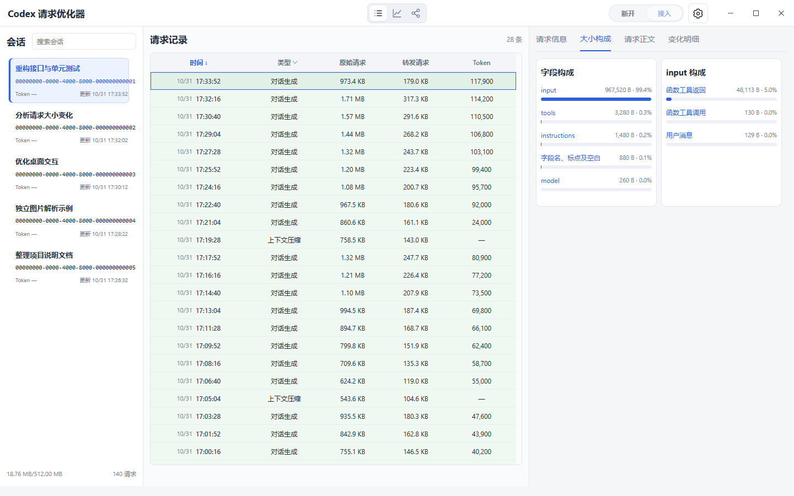
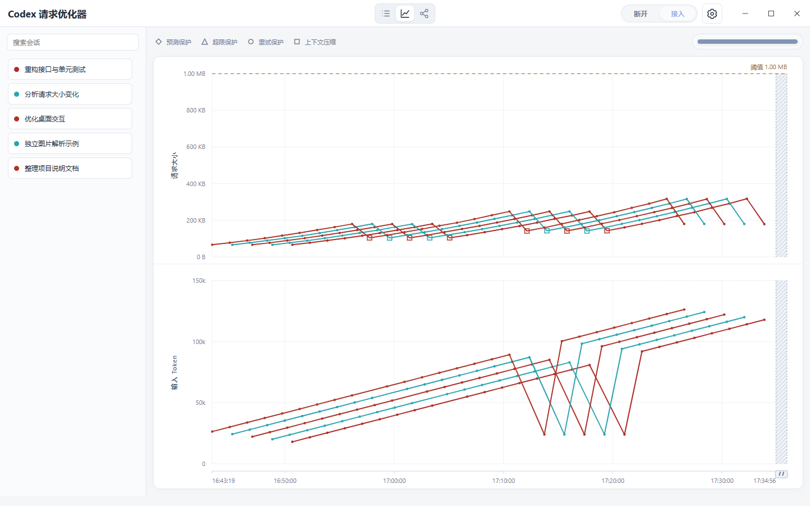
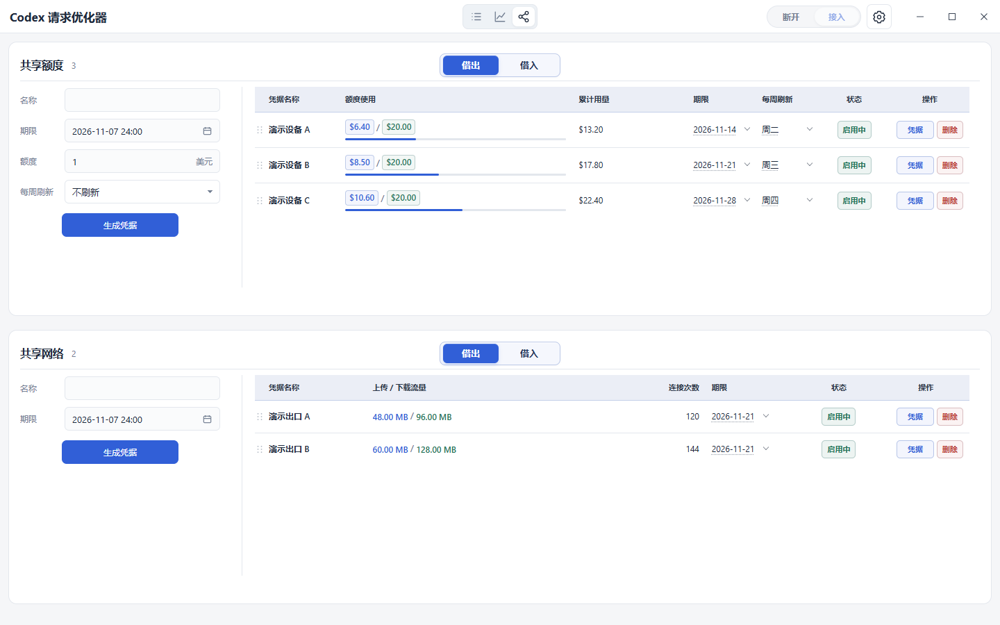
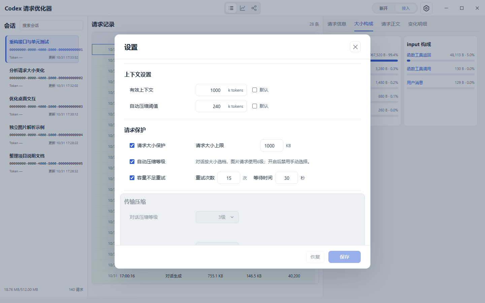

# ⚡ Codex 请求优化器

**简体中文** · [English](https://github.com/qzz1008-glitch/codex-request-optimizer/blob/main/docs/README.en.md)

Codex 的本地请求分析与优化工具，运行于 Windows x64（64 位）。通过压缩减少上传体积，在相同的请求大小限制下容纳更多上下文。

**[⬇️ 下载](https://github.com/qzz1008-glitch/codex-request-optimizer/releases)** · **[📖 使用指南](https://github.com/qzz1008-glitch/codex-request-optimizer/blob/main/docs/usage.md)**

## ✨ 主要功能

- **🗜️ 无损压缩**：减小对话、图片生成和编辑请求的上传体积，保留原有内容；支持自动选档或手动压缩等级。
- **🛡️ 大小保护**：按设定上限控制请求大小；预测保护提前触发上下文压缩，超限保护精简历史后再转发。
- **🧠 上下文配置**：调整上下文窗口和自动压缩阈值，也可恢复模型默认值。
- **🖼️ 图片优化**：开启解图优化后，图片由独立会话解析，减少主会话占用。关闭时使用原生图片解析。大小保护还可对超限图片请求缩图处理（可能损失细节）。
- **🔁 容量重试**：遇到模型容量不足时，让 Codex 自动等待重试，次数和间隔可设置。
- **🔁 请求异常重试**：可选由中转拦截仅含 `Bad Request` 的通用 400，按设置额外重试 1～9 次；默认关闭，启用后默认 3 次，字段或参数错误保持原样。
- **🔎 分析与趋势**：按会话查看请求大小、Token 用量、错误和脱敏 JSON，观察趋势、对比变化及保护触发情况。
- **🤝 局域网共享**：额度与网络出口独立借入或借出，支持凭据管理、有效期、参考费用上限及每周刷新。
- **🖥️ 设备接入**：管理本机（含 WSL）与已保存的 SSH 服务器；远端请求经 SSH 交由本机优化器处理，可分别管理各服务器的连接。

容量重试针对报错：`Selected model is at capacity. Please try a different model.`

## 🖼️ 界面预览

界面图由真实前端和虚构示例数据生成。

📈 趋势分析

🤝 额度与网络共享

⚙️ 上下文、保护与压缩设置

## 🚀 使用

1. 从 [Releases](https://github.com/qzz1008-glitch/codex-request-optimizer/releases) 下载 `CodexPacketInspector.exe`，双击安装运行，无需 Python。
2. 点击“接入”，在设置中调整压缩、保护和图片选项。
3. 按提示重启 Codex 客户端；后续可在设置中检查更新，或运行新版 EXE 升级。

支持中英文切换、托盘驻留和登录后启动，升级保留已有记录与设置。已接入的配置会自动同步，需要重启或处理问题时明确提示。

可在设置中自动检测或手动配置 HTTP/HTTPS 出口代理，并在保存前测试连接。本机、WSL、SSH 服务器和共享的详细操作见[使用指南](https://github.com/qzz1008-glitch/codex-request-optimizer/blob/main/docs/usage.md)。

## 🐧 Linux 服务器版（验证中）

Linux 服务器版正在 EulerOS 3.0 x86_64 上验证，支持中转、压缩、大小保护和请求分析，通过 SSH 隧道访问管理界面。本次公开下载仍提供 Windows EXE；Linux 包需在目标系统构建，详见[构建与使用说明](https://github.com/qzz1008-glitch/codex-request-optimizer/blob/main/docs/usage.md#linux-服务器版)。

## ⚙️ 实现概览

- **接入与转发**：通过 Codex 标准 provider 配置接入本地 Python 中转，处理后的请求继续发往原有上游。接入及升级时检查并统一兼容的旧会话 provider 配置，保留会话内容。
- **压缩与保护**：使用 zstd 进行无损传输压缩，按实际上传大小判断是否触发预测保护或超限保护，控制请求体积。
- **图片解析**：独立图片工具通过标准 MCP stdio 接口由 Codex 管理，每次调用新建独立临时会话识图，只返回文字，结束后清理临时数据。
- **界面与记录**：WebView2 提供桌面界面，SQLite 在本机保存请求记录。认证值不写入采集记录，JSON 浏览与下载使用脱敏副本。

## 📄 许可证

本项目是独立第三方工具，采用 **[MIT License](https://github.com/qzz1008-glitch/codex-request-optimizer/blob/main/LICENSE)**。第三方组件许可证见发布文件中的 `THIRD_PARTY_NOTICES.txt`。
