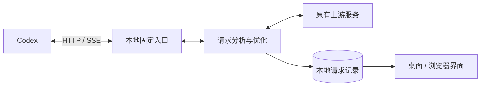

# ⚡ Codex 请求优化器

**简体中文** · [English](https://github.com/qzz1008-glitch/codex-request-optimizer/blob/main/docs/README.en.md)

**Codex Request Optimizer**

一款运行在 Windows x64（64 位）上的 Codex 请求分析与优化工具。按会话查看请求、Token 用量和上传大小，提供无损传输压缩、请求包大小保护、图片处理和模型容量不足重试。

**[⬇️ 下载](https://github.com/qzz1008-glitch/codex-request-optimizer/releases)** · **[📖 使用指南](https://github.com/qzz1008-glitch/codex-request-optimizer/blob/main/docs/usage.md)**

## ✨ 主要功能

### 🔎 会话与请求分析

- “请求与响应”仅展示有记录的结束状态、响应 ID、工具名称等技术信息，省略回复文字、进度说明和空回复占位。响应信息随请求一起保留，不单设保留条数。

按会话集中查看请求记录，了解每次请求发送了什么、占用了多少空间，以及处理结果。

- 显示会话名称、请求时间、模型、响应状态和耗时。
- 将图片解析、自动标题等辅助请求归入父会话；普通子任务独立显示并标记父子关系，未识别请求集中显示在“其他”。
- “图片信息”仅在图片解析的独立会话中显示；普通会话携带历史图片或图片路径时不显示。
- 查看请求的真实输入与输出 Token 用量；无法确认的数据明确标注缺失。
- 顶部切换“记录 / 趋势”：默认查看最近 **1 小时**，普通滚轮前后移动时间，Ctrl＋滚轮以光标为中心缩放，展示时长为 1～12 小时。右上滑动条拖动浏览保留的历史，滑块宽度随展示时长变化。先确定可浏览范围，再按当前时间段分批加载数据；停在历史位置时刷新不跳回最新，拖到最右端恢复跟随最新请求。左侧搜索和定位会话，右上显示包大小、右下显示输入 Token；两图共用时间轴，用颜色区分会话、形状区分保护与重试事件，跳过缺失值连续连接已知点，超限保护标记优先显示。悬停或用键盘聚焦机制图例时，高亮对应节点，其余内容变淡，标记保持会话颜色。包大小沿用请求列表中“处理后包”的口径。
- 分析消息、工具输出、推理内容等部分的大小占比。
- 结构化浏览请求 JSON，比较处理前后的大小，并下载脱敏副本。
- 支持选中文字复制，实时刷新和排序时保留仍然有效的选区。

### 🗜️ zstd 无损传输压缩

减少请求上传体积，保留原有内容和语义。

支持 **1–22 级压缩等级**，压缩大小估算按原始包小于 1.5 MB、达到 1.5 MB 两组展示，并保留本机耗时估算。已经使用 zstd 的请求，也会尝试重新压缩，仅在新包更小时替换。

开启“请求大小保护”后，可使用**按包大小自动压缩**。较小请求保留原包；没有档位记录时，按原始包是否达到 1,500 KB 初选 1 级或 16 级。1 级处理后包达到升档线后，下一条使用 16 级并保持，直到主请求的未压缩正文回到小包范围。两级均按实际处理后包大小执行预测及超限保护。关闭自动模式后恢复手动等级；具体阈值见使用指南。

选档优先沿用已保存的阶段；缺少阶段时，可从上条同上游、同会话请求的概要或详情元数据恢复，不依赖正文或缓存有效期。请求列表和详情使用“原始包 / 处理后包”：原始包在图片处理、传输压缩前测量；处理后包在图片处理、传输压缩后、超限摘要处理前测量。总减小比例包含图片处理和传输压缩，因此未使用 zstd 时也可能减小。压缩方式和等级对应这一阶段；旧记录未保留对应信息时显示“—”。

### 🧠 上下文参数配置

在设置中调整 Codex 客户端使用的上下文窗口和自动压缩阈值，也可恢复模型默认配置。

参数与请求包大小保护分别设置，便于根据使用需求调整。

### 🛡️ 请求包大小保护

针对 **1M（1,000,000 字节）等请求正文大小限制**，支持自定义上限，并提供两种保护机制：

- **预测保护**：请求接近设定阈值时，促使 Codex 提前执行原生上下文压缩，减少后续请求超限的机会。
- **超限保护**：请求已经超过上限时，将已完成的历史内容生成交接摘要，保留必要指令和近期内容，再检查处理后的请求大小。后续请求可以复用对应结果。

预测保护需在完整响应中取得有效 Token 用量才能完成改写。等待期间显示“等待响应”，响应中断导致未完成时显示“未完成”；真实用量本就达到保护值时显示“已满足”。超限摘要成功不代表响应中的 Token 已经改写。

### 🔁 模型容量不足自动重试

启用后，中转在明确的模型容量不足错误中补充原生支持的 `Retry-After` 等待信息，由 Codex 自动等待并继续当前步骤。中转不等待、不重发请求，也不缓存完整响应；文字和工具调用继续实时转发，已开始输出后的容量错误同样可以提供重试提示。

次数可设为 1–99，默认 15 次；等待时间可设为 1–99 秒，默认 30 秒，上游要求更久时遵循上游。次数写入接入 provider 的标准 `stream_max_retries`；同时将 `request_max_retries` 设为 0，避免 HTTP 层再叠加一套请求重试。该原生流重试预算也适用于其他可重试流错误。关闭功能或取消接入时恢复这两个字段原来的值，并保留并发的用户修改。

次数变更需要 Codex 重新加载配置，当前正在运行的步骤不会实时更新；重启 ChatGPT/Codex 后可确保加载。开关作用于后续新请求；等待时间立即作用于已开启功能请求的后续容量错误。次数是上限，取消任务、不可重试错误等仍会结束任务。

普通转发和超限摘要的上游读取空闲超时统一为 300 秒，与 Codex 原生默认值一致。持续收到响应数据时，不限制整轮生成的总时长；超时后由 Codex 按原生规则处理，中转不自行重试。

请求详情中的“原生重试提示”只表示已向 Codex 发送等待信息，不代表已观察到原生实际重试。旧版本的实际重试记录继续保留。后台诊断日志独立于请求正文保留：异常记录最多 30 天，普通成功记录保留 24 小时且最多 2,000 条；总量按 20,000 条、≈33.55 MB 内容预算自动清理。仅记录时间、设置和结构化事件，不保存对话、工具内容或认证信息。

### 🖼️ 图片请求优化

提供**原生 / 禁用 / 优化**三种图片解析模式，默认使用原生工具。

- **原生**：使用 Codex 原生图片工具，卸载本程序安装的优化工具。
- **禁用**：关闭原生及本程序管理的独立图片工具。
- **优化**：将图片保存到本地，在主请求中使用图片路径；由独立会话图片解析工具返回文字结果，减少图片内容对主会话上下文的占用。

图片设置只管理工具安装与图片替换；主页面的接入/断开统一管理所有 provider，与图片模式无关。独立识图会话沿用当前连接，无需专用 provider。可自定义图片保存目录。图片工具入口变化后，需要重新加载 Codex 客户端。

---

## 🚀 使用说明

### 下载安装

1. 前往 **[Releases](https://github.com/qzz1008-glitch/codex-request-optimizer/releases)** 下载 `CodexPacketInspector.exe`。
2. 双击运行，按界面提示完成安装与接入。
3. 在设置中调整上下文参数，并启用需要的保护、重试和图片功能。
4. 首次接入或修改入口端口后，重启正在使用的 Codex 客户端。

正式版 EXE 已包含界面和后台服务，无需自行配置 Python 环境。发布附件另含 README、项目许可证和第三方许可证。

### 日常使用

支持桌面窗口和浏览器访问，默认浏览器地址为：

**[http://127.0.0.1:47844/](http://127.0.0.1:47844/)**

顶栏的“断开 / 接入”开关控制连接状态。接入时关闭 Codex 原生请求压缩，由本软件按等级或自动策略管理 zstd；断开时恢复原上游并开启原生压缩。配置变更后按提示重启 ChatGPT App。

使用 Codex 账户认证的连接统一采用 `OpenAI` 名称，新会话默认使用稳定的 `codex_packet_inspector` 标识；已有会话的旧标识保留为兼容入口，不修改会话历史。API Key 等其他认证方式保持原有连接配置，其原生压缩能力取决于 Codex 自身支持。

左栏选择会话，中栏查看请求，右栏提供请求信息、大小构成、请求正文和变化明细；JSON 支持搜索、路径定位和下载脱敏副本。

关闭桌面窗口后，程序保留在系统托盘。通过托盘退出时，可以切回原出口后退出，或保留接入配置直接退出；处理中请求完成前会保持运行。中英文切换和登录后启动可在设置中调整。

### 设置与保存

设置统一在底部点击“保存”后应用，并显示各步骤的处理结果。“恢复”撤销尚未保存的修改；上下文参数旁的“默认”用于恢复模型默认值。需要重启 Codex 才能生效的配置会单独提示。

### 在线升级

在设置中检查更新并升级。程序会校验下载文件，更新桌面窗口与后台服务，并保留已有记录和设置。升级也会刷新托盘和本程序的快捷方式，保留登录启动开关；过期的程序副本会自动回收。

正常升级时，新请求交给新版服务，处理中请求由原服务继续完成。

### 本地数据

默认数据目录为：

```text
%USERPROFILE%\.codex-packet-inspector
```

请求记录、设置、配置备份及图片附件保存在本机。详细操作见 **[使用指南](https://github.com/qzz1008-glitch/codex-request-optimizer/blob/main/docs/usage.md)**。

大小统一使用十进制单位：1 KB = 1,000 字节，1 MB = 1,000,000 字节。升级保留自定义存储上限的原字节数；旧默认额度的迁移规则见下文。

请求记录默认最多保留 **500 MB / 2,000 条**，可在“记录设置”中调整。左栏底部显示已保存记录的占用 / 存储上限、当前请求数；占用按记录内容计算，不代表整个数据目录的实际磁盘占用。

---

## ⚙️ 实现原理

### 请求处理流程

程序通过 Codex 的标准 **provider 配置**接入本机 HTTP 出口，维护原有上游地址、认证方式及附加请求头的对应关系。



固定入口接收请求，由后台服务完成分析和已启用的优化，再转发给原有上游。响应以流式方式返回，界面读取本地记录展示请求详情。

### 压缩与保护机制

| 机制 | 实现方式 |
| :--- | :--- |
| **无损传输压缩** | 使用 zstd 压缩上传正文。对已有 zstd 请求尝试重新压缩，比较大小后决定是否替换。 |
| **预测保护** | 根据编码后的请求大小判断风险，提高成功响应中的输入 Token 计数，促使 Codex 执行原生压缩；真实上游用量单独保存供统计。 |
| **超限保护** | 找出可处理的历史前缀，通过 Responses 请求生成交接摘要，重新组合请求并检查上传大小。 |
| **结果复用** | 按会话保存历史前缀指纹和处理结果，匹配后复用，历史或相关配置变化时重新判断。 |
| **容量不足重试** | 为 HTTP 或流式容量错误添加等待信息，由 Codex 原生按设置重试。 |

### 图片处理与独立解析

图片处理分为本地附件保存和独立解析工具两个部分。

启用后，中转将内嵌图片保存为本地附件，并在发往上游的主请求中使用图片路径。EXE 安装并注册独立的 stdio MCP 图片工具，由 Codex 启动工具、在独立会话中完成识别，再将文字结果返回主会话。工具通过 Windows 自带的 PowerShell 运行，运行代码与 EXE 分离；EXE 负责安装、升级和卸载，不提供图片工具 HTTP 接口，也不使用工具 Hook。选择“原生”会卸载本程序安装的图片工具并恢复原生 `view_image`。

图片优化会将系统临时目录中的 `codex-clipboard-*` 图片复制到 `%TEMP%\CodexRequestOptimizer\`，当前请求改用副本路径，原文件保留。副本缓存最多 ≈268.44 MB，后续处理图片时清理超过 7 天未使用的副本；复制失败时保留原路径。

### 用量与请求记录

Token 用量优先直接采集成功的上游响应，与包大小保护开关无关；旧记录缺少响应用量时才读取 Codex 本机已有记录。用量展示不再读取或显示窗口上限及占用百分比。数据无法匹配或尚未写入时，界面显示缺失或等待状态。

请求记录与处理结果使用 **SQLite** 保存。敏感认证头用于转发，采集记录不保存其值；界面浏览和 JSON 下载使用脱敏副本。

存储额度按压缩后的脱敏请求副本与请求元数据的字节数计算。SQLite 的索引、日志和可复用空间会使数据库文件的实际占用与此数值不同；摘要缓存、诊断日志和图片附件使用各自的保留规则。

记录设置只控制记录上限 **N** 和合计存储额度 **Z**，默认 2,000 条、500 MB。在存储额度内优先保留最近 N 条请求的基本信息，再用剩余空间尽量保留更多请求详情，不单独设置详情条数上限。基本信息保留会话归属、时间、状态、包大小、真实 Token、保护标记及大小构成统计，可继续填充请求信息、列表和图表；正文、HTTP 头及包含正文片段的输入条目摘要随详情回收。

响应概要随请求基本信息保留，正文详情回收后仍可查看；请求删除时一起删除，不单独设置数量。只保存真实用量汇总及缓存统计，逐条 Token 归因明细不进入本地记录；旧记录分批精简，不影响原请求正文。

超过 Z 时先按创建时间回收旧详情，基本信息仍保留；基本信息本身也超额时才淘汰最旧请求。不按请求状态豁免记录，回收不会中断正在转发的请求，后续响应也不会重建已回收的详情或记录。调小上限后立即回收，调大后只影响后续保留，无法恢复已回收内容。升级保留原有 N 和自定义额度，旧默认额度 536.870912 MB 一次性调整为 500 MB，旧详情条数限制停用；启动时会将已停用旧采集模块遗留的未完成记录标记为中断。

### 桌面与后台

| 技术 | 用途 |
| :--- | :--- |
| **Python** | 本地 HTTP 服务、请求处理和配置管理 |
| **zstandard** | 请求正文的 zstd 压缩与解压 |
| **SQLite** | 请求记录与历史处理结果缓存 |
| **HTML / CSS / JavaScript** | 三栏界面、请求分析和设置页面 |
| **pywebview / WebView2** | Windows 桌面窗口 |
| **PyInstaller** | 单文件 EXE 构建 |

桌面窗口与中转服务分进程运行，通过本机接口通信。升级时先启动并验证新版后台，再切换新请求，原后台完成已有请求后退出。

### 构建与发布

统一构建入口为：

```powershell
python -m scripts.build_inspector --mode release
```

构建过程冻结完整源码，记录 Git 提交及文件指纹，并核对 EXE 内嵌资源与前端内容。正式发布使用已整合的干净 `main`，构建期间源码变化时作废重打。

开发环境、前端热更新、测试和构建流程见 **[开发与构建](https://github.com/qzz1008-glitch/codex-request-optimizer/blob/main/docs/development.md)**。

---

## 📄 许可证

本项目是独立第三方工具，采用 **[MIT License](https://github.com/qzz1008-glitch/codex-request-optimizer/blob/main/LICENSE)**。

第三方组件说明及许可证见发布文件中的 `THIRD_PARTY_NOTICES.txt`。
