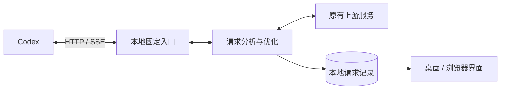

# ⚡ Codex 请求优化器

**简体中文** · [English](https://github.com/qzz1008-glitch/codex-request-optimizer/blob/main/docs/README.en.md)

**Codex Request Optimizer**

一款运行在 Windows x64（64 位）上的 Codex 请求分析与优化工具。按会话查看请求、Token 用量和上传大小，提供无损传输压缩、请求包大小保护、图片处理和模型容量不足重试。

**[⬇️ 下载](https://github.com/qzz1008-glitch/codex-request-optimizer/releases)** · **[📖 使用指南](https://github.com/qzz1008-glitch/codex-request-optimizer/blob/main/docs/usage.md)**

## ✨ 主要功能

### 🔎 会话与请求分析

按会话集中查看请求记录，了解每次请求发送了什么、占用了多少空间，以及处理结果。

- 显示会话名称、请求时间、模型、响应状态和耗时。
- 将图片解析、自动标题等辅助请求归入父会话；普通子任务独立显示并标记父子关系，未识别请求集中显示在“其他”。
- “图片信息”仅在图片解析的独立会话中显示；普通会话携带历史图片或图片路径时不显示。
- 查看请求的真实输入与输出 Token 用量；无法确认的数据明确标注缺失。
- 右上角切换“记录 / 趋势”：所有会话共用时间轴，实时比较输入 Token 变化，并标记保护、重试和压缩事件。
- 分析消息、工具输出、推理内容等部分的大小占比。
- 结构化浏览请求 JSON，比较处理前后的大小，并下载脱敏副本。
- 支持选中文字复制，实时刷新和排序时保留仍然有效的选区。

### 🗜️ zstd 无损传输压缩

减少请求上传体积，保留原有内容和语义。

支持 **1–17 级压缩等级**，可比较压缩大小和本机耗时估算。已经使用 zstd 的请求，也会尝试重新压缩，仅在新包更小时替换。

开启“请求大小保护”后，可使用**按包大小自动压缩**。较小请求保留原包，其余请求根据会话的上传大小，在 1 级快速压缩和 17 级高压缩之间自动选择。关闭自动模式后恢复手动等级；具体阈值见使用指南。

### 🧠 上下文参数配置

在设置中调整 Codex 客户端使用的上下文窗口和自动压缩阈值，也可恢复模型默认配置。

参数与请求包大小保护分别设置，便于根据使用需求调整。

### 🛡️ 请求包大小保护

针对 **1M（1,000,000 字节）等请求正文大小限制**，支持自定义上限，并提供两种保护机制：

- **预测保护**：请求接近设定阈值时，促使 Codex 提前执行原生上下文压缩，减少后续请求超限的机会。
- **超限保护**：请求已经超过上限时，将已完成的历史内容生成交接摘要，保留必要指令和近期内容，再检查处理后的请求大小。后续请求可以复用对应结果。

### 🔁 模型容量不足自动重试

遇到明确的模型容量不足错误时，保持原模型和请求内容，按设置自动重试。

> Selected model is at capacity. Please try a different model.

### 🖼️ 图片请求优化

提供**原生 / 禁用 / 优化**三种图片解析模式，默认使用原生工具。

- **原生**：使用 Codex 原生图片工具，卸载本程序安装的优化工具。
- **禁用**：关闭原生及本程序管理的独立图片工具。
- **优化**：将图片保存到本地，在主请求中使用图片路径；由独立会话图片解析工具返回文字结果，减少图片内容对主会话上下文的占用。

可自定义图片保存目录。图片工具入口变化后，需要重新加载 Codex 客户端。

---

## 🚀 使用说明

### 下载安装

1. 前往 **[Releases](https://github.com/qzz1008-glitch/codex-request-optimizer/releases)** 下载 `CodexPacketInspector.exe`。
2. 双击运行，按界面提示完成安装与接入。
3. 在设置中调整上下文参数，并启用需要的保护、重试和图片功能。
4. 首次接入或修改入口端口后，重启正在使用的 Codex 客户端。

正式版 EXE 已包含界面和后台服务，无需自行配置 Python 环境。发布附件另含 README、项目许可证和第三方许可证。

### 日常使用

支持桌面窗口和浏览器访问，默认浏览器地址为：

**[http://127.0.0.1:47844/](http://127.0.0.1:47844/)**

顶栏提供“断开 / 分析 / 优化”切换。左栏选择会话，中栏查看请求，右栏提供请求信息、大小构成、请求正文和变化明细；JSON 支持搜索、路径定位和下载脱敏副本。

关闭桌面窗口后，程序保留在系统托盘。通过托盘退出时，可以切回原出口后退出，或保留接入配置直接退出；处理中请求完成前会保持运行。中英文切换和登录后启动可在设置中调整。

### 设置与保存

设置统一在底部点击“保存”后应用，并显示各步骤的处理结果。“恢复”撤销尚未保存的修改；上下文参数旁的“默认”用于恢复模型默认值。需要重启 Codex 才能生效的配置会单独提示。

### 在线升级

在设置中检查更新并升级。程序会校验下载文件，更新桌面窗口与后台服务，并保留已有记录和设置。

正常升级时，新请求交给新版服务，处理中请求由原服务继续完成。

### 本地数据

默认数据目录为：

```text
%USERPROFILE%\.codex-packet-inspector
```

请求记录、设置、配置备份及图片附件保存在本机。详细操作见 **[使用指南](https://github.com/qzz1008-glitch/codex-request-optimizer/blob/main/docs/usage.md)**。

---

## ⚙️ 实现原理

### 请求处理流程

程序通过 Codex 的标准 **provider 配置**接入本机 HTTP 出口，维护原有上游地址、认证方式及附加请求头的对应关系。



固定入口接收请求，由后台服务完成分析和已启用的优化，再转发给原有上游。响应以流式方式返回，界面读取本地记录展示请求详情。

### 压缩与保护机制

| 机制 | 实现方式 |
| :--- | :--- |
| **无损传输压缩** | 使用 zstd 压缩上传正文。对已有 zstd 请求尝试重新压缩，比较大小后决定是否替换。 |
| **预测保护** | 根据编码后的请求大小判断风险，提高成功响应中的输入 Token 计数，促使 Codex 执行原生压缩；真实上游用量单独保存供统计。 |
| **超限保护** | 找出可处理的历史前缀，通过 Responses 请求生成交接摘要，重新组合请求并检查上传大小。 |
| **结果复用** | 按会话保存历史前缀指纹和处理结果，匹配后复用，历史或相关配置变化时重新判断。 |
| **容量不足重试** | 识别 HTTP 或流式响应中的明确容量错误，按设置使用同一模型和请求重试。 |

### 图片处理与独立解析

图片处理分为本地附件保存和独立解析工具两个部分。

启用后，中转将内嵌图片保存为本地附件，并在发往上游的主请求中使用图片路径。EXE 安装并注册独立的 stdio MCP 图片工具，由 Codex 启动工具、在独立会话中完成识别，再将文字结果返回主会话。工具通过 Windows 自带的 PowerShell 运行，运行代码与 EXE 分离；EXE 负责安装、升级和卸载，不提供图片工具 HTTP 接口，也不使用工具 Hook。选择“原生”会卸载本程序安装的图片工具并恢复原生 `view_image`。

图片优化会将系统临时目录中的 `codex-clipboard-*` 图片复制到 `%TEMP%\CodexRequestOptimizer\`，当前请求改用副本路径，原文件保留。副本缓存最多 256 MiB，后续处理图片时清理超过 7 天未使用的副本；复制失败时保留原路径。

### 用量与请求记录

Token 用量优先直接采集成功的上游响应，与包大小保护开关无关；旧记录缺少响应用量时才读取 Codex 本机已有记录。用量展示不再读取或显示窗口上限及占用百分比。数据无法匹配或尚未写入时，界面显示缺失或等待状态。

请求记录与处理结果使用 **SQLite** 保存。敏感认证头用于转发，采集记录不保存其值；界面浏览和 JSON 下载使用脱敏副本。

### 桌面与后台

| 技术 | 用途 |
| :--- | :--- |
| **Python** | 本地 HTTP 服务、请求处理和配置管理 |
| **zstandard** | 请求正文的 zstd 压缩与解压 |
| **SQLite** | 请求记录与历史处理结果缓存 |
| **HTML / CSS / JavaScript** | 三栏界面、请求分析和设置页面 |
| **pywebview / WebView2** | Windows 桌面窗口 |
| **PyInstaller** | 单文件 EXE 构建 |

桌面窗口与中转服务分进程运行，通过本机接口通信。升级时先启动并验证新版后台，再切换新请求，原后台完成已有请求后退出。

### 构建与发布

统一构建入口为：

```powershell
python -m scripts.build_inspector --mode release
```

构建过程冻结完整源码，记录 Git 提交及文件指纹，并核对 EXE 内嵌资源与前端内容。正式发布使用已整合的干净 `main`，构建期间源码变化时作废重打。

开发环境、前端热更新、测试和构建流程见 **[开发与构建](https://github.com/qzz1008-glitch/codex-request-optimizer/blob/main/docs/development.md)**。

---

## 📄 许可证

本项目是独立第三方工具，采用 **[MIT License](https://github.com/qzz1008-glitch/codex-request-optimizer/blob/main/LICENSE)**。

第三方组件说明及许可证见发布文件中的 `THIRD_PARTY_NOTICES.txt`。
