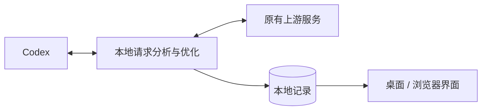

# ⚡ Codex 请求优化器

**简体中文** · [English](https://github.com/qzz1008-glitch/codex-request-optimizer/blob/main/docs/README.en.md)

**Codex Request Optimizer** 是一款运行在 Windows x64（64 位）上的 Codex 请求分析与优化工具，提供会话与请求分析、无损传输压缩、请求大小保护、图片优化和模型容量不足自动重试。

**[⬇️ 下载](https://github.com/qzz1008-glitch/codex-request-optimizer/releases)** · **[📖 使用指南](https://github.com/qzz1008-glitch/codex-request-optimizer/blob/main/docs/usage.md)**

## ✨ 主要功能

### 🔎 会话与请求分析

按会话集中查看请求，了解每次发送了什么、占用了多少空间，以及处理结果。

- 查看会话名称、请求时间、模型、结果、总耗时及错误原因。
- 查看真实输入与输出 Token 用量；无法确认的数据明确标注缺失。
- 将图片解析、自动标题等辅助请求归入父会话，普通子任务独立显示，未识别请求集中显示在“其他”。
- 分析消息、工具输出、推理内容等部分的大小占比，对比同一会话前后请求的变化。
- 结构化浏览请求 JSON，支持搜索、路径定位和下载脱敏副本。
- 支持选中文字复制，实时刷新和排序时保留仍然有效的选区。

### 📈 趋势与历史浏览

把请求大小和输入 Token 放在同一时间轴上，观察会话增长及保护机制的触发情况。

- 默认展示最近 **1 小时**，可缩放查看 **1–12 小时**的时间范围。
- 用滚轮前后移动时间，Ctrl＋滚轮以光标为中心缩放，也可拖动时间滑动条浏览历史。
- 浏览历史时保持当前位置；拖到最右端后，继续跟随最新请求。
- 用颜色区分会话，用标记区分预测保护、超限保护、重试保护及原生上下文压缩。
- 支持搜索和定位会话、悬停查看请求，以及通过机制图例高亮对应节点。

### 🗜️ zstd 无损传输压缩

减少请求上传体积，保留原有内容和语义。

- 支持 **1–22 级压缩等级**，展示不同等级的压缩大小与本机耗时估算，便于选择。
- 估算按原始请求小于 1.5 MB、达到 1.5 MB 两组展示，颜色反映各组内的相对效果。
- 支持进一步优化已有 zstd 请求，仅在压缩包更小时替换。
- 开启请求大小保护后，可使用**按请求大小自动压缩**：小请求保留原包，较大请求在快速档和高压缩档之间自动选择，回到小包范围后解除高压缩状态。
- 查看“原始包 / 处理后包”、减少比例、压缩方式和等级；具体统计口径与自动选档规则见使用指南。

### 🧠 上下文参数配置

在设置中调整 Codex 使用的上下文窗口和自动压缩阈值，也可恢复模型默认值。上下文参数与请求大小保护分别设置，便于按使用需求调整。

### 🛡️ 请求大小保护

面向 **1M（1,000,000 字节）等请求正文限制**，避免请求因正文过大被网关拦截。支持自定义大小上限，并提供两种保护机制：

- **预测保护**：请求接近上限时，促使 Codex 提前执行原生上下文压缩，为后续请求留出空间。
- **超限保护**：请求已超过上限时，将已完成的历史整理成交接摘要，保留必要指令与近期内容，减小请求后再转发；后续请求可复用对应结果。

请求列表、详情和趋势图展示保护是否触发及对应状态，便于查看每次处理的效果。

### 🔁 模型容量不足自动重试

针对以下容量不足错误，向 Codex 提供等待信息，由 Codex 自动等待并重试，继续当前步骤：

> Selected model is at capacity. Please try a different model.

- 重试次数支持 **1–99 次**，默认 **15 次**。
- 等待时间支持 **1–99 秒**，默认 **30 秒**；上游要求更久时遵循上游。
- 文字与工具调用保持流式转发。
- 修改重试次数后，需要重新加载 Codex 配置，按界面提示重启客户端即可。

界面中的“重试保护已触发”表示已向 Codex 提供等待信息，实际重试由 Codex 执行。

### 🖼️ 图片请求优化

提供**原生 / 禁用 / 优化**三种模式，默认使用原生工具。

- **原生**：使用 Codex 原生图片工具。
- **禁用**：关闭原生及本程序管理的图片解析工具。
- **优化**：将主请求中的图片内容替换为本地路径，由独立会话图片解析工具返回文字结果，减少图片对主会话上下文的占用。

可自定义图片保存目录。切换图片工具后，按界面提示重新加载 Codex 客户端。

---

## 🚀 使用说明

### 下载安装

1. 前往 **[Releases](https://github.com/qzz1008-glitch/codex-request-optimizer/releases)** 下载 `CodexPacketInspector.exe`。
2. 双击运行，按界面提示完成安装与接入。
3. 在设置中调整上下文参数，启用需要的保护、重试和图片功能。
4. 首次接入或修改入口端口后，重启正在使用的 Codex 客户端。

正式版 EXE 已包含界面和后台服务，无需自行配置 Python 环境。

### 日常使用

- 顶栏的“断开 / 接入”控制连接状态；断开时恢复原上游，接入时由本软件处理请求。
- 左栏选择会话，中栏查看请求，右栏浏览请求信息、大小构成、请求正文和变化明细；顶栏可切换记录与趋势视图。
- 关闭窗口后保留在系统托盘；退出时等待处理中请求完成。中英文切换和登录后启动可在设置中调整。
- 支持桌面窗口和浏览器访问，默认浏览器地址为 **[http://127.0.0.1:47844/](http://127.0.0.1:47844/)**。

### 设置与保存

设置统一点击底部“保存”后应用。“恢复”撤销未保存的修改，上下文参数旁的“默认”用于恢复模型默认值。需要重启 Codex 才能生效的配置会单独提示。

### 在线升级

在设置中检查更新并升级，也可下载新版 EXE 直接运行。升级保留已有记录、设置及开发版／正式版模式；新请求交给新版服务，处理中请求由原服务继续完成。

发布附件仅包含正式 EXE、README、项目许可证和第三方许可证。

### 本地数据与隐私

默认数据目录：

```text
%USERPROFILE%\.codex-packet-inspector
```

- 请求记录、设置、配置备份和图片附件保存在本机。
- 认证头用于转发，采集记录不保存认证值；JSON 浏览和下载使用脱敏副本。
- 请求记录默认最多保留 **500 MB / 2,000 条**，可在“记录设置”中调整。
- 空间不足时优先回收旧详情，尽量保留基本信息、真实用量和趋势数据，必要时再淘汰旧记录。已回收的详情无法恢复。
- 大小使用十进制单位：1 KB = 1,000 字节，1 MB = 1,000,000 字节；界面显示的是记录内容占用。

详细操作与配置说明见 **[使用指南](https://github.com/qzz1008-glitch/codex-request-optimizer/blob/main/docs/usage.md)**。

---

## ⚙️ 实现概览

通过 Codex 的标准 **provider 配置**接入本地中转，在本机完成分析、压缩与保护，再转发给原有上游；响应以流式方式返回。



本地服务使用 **Python**，传输压缩使用 **zstd**，请求记录保存在 **SQLite**；界面使用 HTML / CSS / JavaScript，通过 **pywebview / WebView2** 提供 Windows 桌面窗口。图片解析由独立工具和会话完成。

Token 用量优先采集真实上游响应，缺失时只读已有 Codex 本机记录；无法确认的数据保留缺失状态。

开发环境、热更新、测试和构建流程见 **[开发与构建](https://github.com/qzz1008-glitch/codex-request-optimizer/blob/main/docs/development.md)**。

---

## 📄 许可证

本项目是独立第三方工具，采用 **[MIT License](https://github.com/qzz1008-glitch/codex-request-optimizer/blob/main/LICENSE)**。

第三方组件说明及许可证见发布文件中的 `THIRD_PARTY_NOTICES.txt`。
