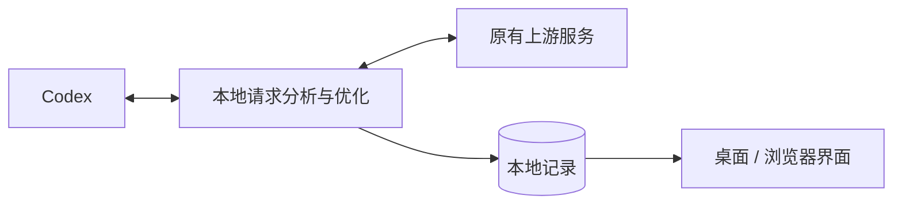

# ⚡ Codex 请求优化器

**简体中文** · [English](https://github.com/qzz1008-glitch/codex-request-optimizer/blob/main/docs/README.en.md)

**Codex Request Optimizer** 是一款运行在 Windows x64（64 位）上的 Codex 请求分析与优化工具，提供会话与请求分析、无损传输压缩、请求大小保护、图片优化和模型容量不足自动重试。

**[⬇️ 下载](https://github.com/qzz1008-glitch/codex-request-optimizer/releases)** · **[📖 使用指南](https://github.com/qzz1008-glitch/codex-request-optimizer/blob/main/docs/usage.md)**

## ✨ 主要功能

### 🔎 会话与请求分析

按会话集中查看请求，了解每次发送了什么、占用了多少空间，以及处理结果。

- 查看会话名称、请求时间、模型、结果、总耗时及错误原因。
- 查看真实输入与输出 Token 用量；无法确认的数据明确标注缺失。
- 将图片解析、自动标题等辅助请求归入父会话，普通子任务独立显示，未识别请求集中显示在“其他”。
- 分析消息、工具输出、推理内容等部分的大小占比，对比同一会话前后请求的变化。
- 结构化浏览请求 JSON，支持搜索、路径定位和下载脱敏副本。
- 支持选中文字复制，实时刷新和排序时保留仍然有效的选区。
- 右键托盘打开白色面板，查看接入状态、保留请求条数／时间范围／会话数、触发保护的请求数，以及压缩前上下文的平均输入 Token；统计随保留记录更新。冷启动预热期间使用原生菜单，打开窗口和退出操作始终可用。

### 📈 趋势与历史浏览

把请求大小和输入 Token 放在同一时间轴上，观察会话增长及保护机制的触发情况。

中栏和趋势统一显示超限摘要处理前的输入 Token：未发生摘要时采用真实用量；发生摘要时显示带 `≈` 的估算值。估算沿用 Codex 的内容折算规则，并在模型、请求参数和输入前缀匹配时，以未被摘要的真实用量校准新增内容。右栏保留摘要后的真实上游用量；缺少可靠估算条件时显示“—”。

- 默认展示省去空档后的 **1 小时**，可缩放查看 **1–12 小时**的范围；节点保留实际时间。
- 用滚轮前后移动时间，Ctrl＋滚轮以光标为中心缩放，也可拖动时间滑动条浏览历史。
- 浏览历史时保持当前位置；拖到最右端后，继续跟随最新请求。
- 无请求的长空档自动省去大部分，曲线连续连接；时间轴标记跳过的时段，悬停查看实际起止时间，两张图保持对齐。
- 用颜色区分会话，用标记区分预测保护、超限保护、重试保护及原生上下文压缩。
- 支持搜索和定位会话、悬停查看请求，以及通过机制图例高亮对应节点。

### 🗜️ zstd 无损传输压缩

减少请求上传体积，保留原有内容和语义。

- 支持对话以及图片生成、图片编辑的 JSON 请求无损压缩，图片内容和画质不变；列表和筛选分别显示这三类请求。
- 对话和图片请求分别设置压缩等级，图片默认 **6 级**；智能模式的图片请求固定使用经离线测试选定的 **6 级**，手动模式使用图片所选等级，运行时不试压选级。
- 开启“请求大小保护”后，图片请求在传输压缩后仍超限时会等比缩小输入图，可能损失细节；关闭时仅做无损传输压缩。保留原文件和透明度，最多两轮，每轮从原图生成，兼容明确的编辑蒙版。
- 对话和图片的等级选择框均支持 **1–22 级压缩等级**，分别展示采样估算的大小变化与单次压缩耗时（ms）。
- 估算按原始请求小于 1.5 MB、达到 1.5 MB 两组展示，颜色反映各组内的相对效果。
- 支持进一步优化已有 zstd 请求，仅在压缩包更小时替换。
- 开启请求大小保护后，可使用**按请求大小自动压缩**：小请求保留原包，较大请求在快速档和高压缩档之间自动选择，回到小包范围后解除高压缩状态。
- 查看“原始请求 / 转发请求”、减少比例、压缩方式和等级；具体统计口径与自动选档规则见使用指南。

### 🧠 上下文参数配置

在设置中调整 Codex 使用的上下文窗口和自动压缩阈值，也可恢复模型默认值。上下文参数与请求大小保护分别设置，便于按使用需求调整。

### 🛡️ 请求大小保护

面向 **1M（1,000,000 字节）等请求正文限制**，避免请求因正文过大被网关拦截。支持自定义大小上限，并提供两种保护机制：

- **预测保护**：请求接近上限时，促使 Codex 提前执行原生上下文压缩，为后续请求留出空间。
- **超限保护**：请求已超过上限时，将已完成的历史整理成交接摘要，保留必要指令与近期内容，减小请求后再转发；后续请求可复用对应结果。

请求列表、详情和趋势图展示保护是否触发及对应状态，便于查看每次处理的效果。

### 🔁 模型容量不足自动重试

针对以下容量不足错误，向 Codex 提供等待信息，由 Codex 自动等待并重试，继续当前步骤：

> Selected model is at capacity. Please try a different model.

- 重试次数支持 **1–99 次**，默认 **15 次**。
- 等待时间支持 **1–99 秒**，默认 **30 秒**；上游要求更久时遵循上游。
- 文字与工具调用保持流式转发。
- 修改重试次数后，需要重新加载 Codex 配置，按界面提示重启客户端即可。

界面中的“重试保护已触发”表示已向 Codex 提供等待信息，实际重试由 Codex 执行。

### 🖼️ 图片请求优化

提供**原生 / 禁用 / 优化**三种模式，默认使用原生工具。

- **原生**：使用 Codex 原生图片工具。
- **禁用**：关闭原生及本程序管理的图片解析工具。
- **优化**：将主请求中用户消息和工具返回的内嵌图片替换为本地路径，保留工具调用关系及其他内容，由独立会话图片解析工具返回文字结果，减少图片对主会话上下文的占用。

可自定义图片保存目录。切换图片工具后，按界面提示重新加载 Codex 客户端。

---

### 🤝 局域网共享

- 独立的“共享”标签页：左侧为额度、出口两张卡片，分别切换借入或借出，用于生成或保存凭据；右侧上下分别显示额度、出口凭据列表，各自独立滚动，同时显示借入与借出记录，切换左侧表单不改变列表。额度列表显示已用／额度及细进度条、本周／累计用量；出口列表显示上传／下载流量、连接次数。两表均显示名称、期限、状态和操作，支持调整额度、期限及启停凭据。停用最后一张有效凭据后停止对应借出，右侧启用已有凭据可恢复借出。不影响原有记录和趋势视图，双方安装本软件，无需维护账号池。
- 借出时填写名称并生成凭据。同类型凭据不能重名，借入与借出共同校验，忽略名称首尾空格和大小写；停用、到期的凭据仍保留名称。额度和出口可使用相同名称。同一张额度凭据可以供多台机器使用，共用额度上限和用量统计；每张出口凭据在首次使用时绑定一台机器的持久客户端标识，不按 IP 绑定。同一机器可重复连接，绑定跨重启、升级保留；其他机器需另建出口凭据。已有未绑定出口凭据从升级后的首次使用开始绑定，原额度、期限和历史用量保留。
- 期限直接显示可编辑的本机日期和时间，精确到分钟；新建时默认一周后，可勾选“无期限”。列表同样显示完整的到期日期和时间。新设的到期时间至少一天后，无期限仍可使用。右侧可编辑每张借出凭据的有效期、额度及每周刷新选项，也可停用、复制或手动重置额度。已有配置保持不变，未修改的旧期限和旧额度可以保留；更改作用于新请求，已经开始的请求和通道可以完成。提供方需保持应用和共享运行。
- 额度以美元参考费用计量，按实际上游输入、缓存读取、缓存写入、输出及已知模型、服务档位、长上下文价格估算。推理 Token 已包含在输出中，不重复计费。未知模型、未知缓存写入类型或缺失用量单独标记，不伪造费用。价格参考 [官方 API 价格](https://developers.openai.com/api/docs/pricing)，不代表 ChatGPT 订阅实际扣费或余额，Pro $200/月也不等同于 $200 API 余额。
- 每张额度凭据按美元设置本期额度上限，新建和修改的额度最低 $1，默认 $1；不设置 Token 数量或转发次数上限。达到已计参考费用上限后拒绝新请求；进行中及用量缺失的请求可能使额度超出或低估。每周刷新在提供方本机时间周一零点进行；手动重置仅清零本期消耗，保留累计和本周统计。重置前已开始的请求不扣入新一期额度。
- 借入的额度、出口凭据均保存到历史列表，可选择当前生效的一张；每台机器至多借用一个额度来源、选择一个网络出口。借入方只读查看提供方的有效期与额度，当前来源定期同步，其余历史显示最近同步值。额度借出与借入在整台机器互斥，借出只使用本机原生授权，不转借他人额度。更换来源先验证，失败保留原选择。
- 借用额度时可选择额度提供方的本机出口、自己的本机出口或第三方共享出口；自己的出口自动建立回接通道。正常生成、原生 compact、超限摘要及图片解析使用同一额度与出口，请求准备期间切换设置不改变该次请求路由。仅借用出口时仍使用自己的额度，主页面需保持接入。
- 借出的出口始终使用本机网络及系统代理，忽略本机选择的其他共享出口，因此双方互选也不形成出口链。出口只允许到 Codex 官方 HTTPS 上游的 CONNECT 隧道，保留上游端到端 TLS，只统计加密流量与连接数，不读取对话、上游凭据或 Token。大于 1 MB 的上传权限取决于出口实际网络策略。
- 借用方负责工具、图片、传输压缩、预测保护、超限摘要、原生重试及本地记录；额度提供方直接流式转发，不重复保护或重试。共享请求不进入提供方的采集、原有图表、网络诊断及重试诊断。共享账本只保存每张凭据的汇总与每日费用、Token 或流量，不保存借用方的请求正文、回复、工具结果或会话信息。连接或出口失效直接报错，不自动换账号或出口。
- 上游账号授权始终由提供方的 Codex 管理与续期，不写入借入方配置或共享账本。Windows 上保存的应用凭据、借入链接、客户端标识及共享 TLS 私钥使用当前用户的 DPAPI 保护。连接在发送凭据前验证链接中的证书指纹，无需安装证书。统计及凭据历史跨应用重启保留；退出停止共享，重启不会自动开启借出或借入，手动恢复后可继续使用原凭据（地址和端口需仍可达）。
- 软件自动选择局域网地址。额度和出口端口在设置中修改，下次开启共享生效，不中断现有连接。使用方粘贴 `codex-share://` 或 `codex-exit://` 凭据即可保存并借入。双方需要支持凭据管理协议；旧协议在修改借入配置前拒绝。
- 断开额度借入后恢复主配置、活动 profile 及独立图片 profile 原有的 provider 选择，并保留无关改动；按提示重载 Codex 配置或重启 ChatGPT，现有会话可能继续沿用旧连接。双方网络、防火墙需允许共享入口，自己的出口回接还要求额度提供方能连接借入方；共享入口不开放本机设置和请求历史。额度提供方会在内存中转发正文，请仅与可信同事共享。

## 🚀 使用说明

### 下载安装

1. 前往 **[Releases](https://github.com/qzz1008-glitch/codex-request-optimizer/releases)** 下载 `CodexPacketInspector.exe`。
2. 双击运行，按界面提示完成安装与接入。
3. 在设置中调整上下文参数，启用需要的保护、重试和图片功能。
4. 首次接入或修改入口端口后，重启正在使用的 Codex 客户端。

正式版 EXE 已包含界面和后台服务，无需自行配置 Python 环境。

### 日常使用

- 顶栏的“断开 / 接入”控制连接状态；断开时恢复原上游，接入时由本软件处理请求。
- 左栏选择会话，中栏查看请求，右栏浏览请求信息、大小构成、请求正文和变化明细；顶栏可切换记录与趋势视图。
- 关闭窗口后保留在系统托盘；退出时等待处理中请求完成。中英文切换和登录后启动可在设置中调整。
- 支持桌面窗口和浏览器访问，默认浏览器地址为 **[http://127.0.0.1:47844/](http://127.0.0.1:47844/)**。

### 设置与保存

设置统一点击底部“保存”后应用。“恢复”撤销未保存的修改，上下文参数旁的“默认”用于恢复模型默认值。需要重启 Codex 才能生效的配置会单独提示。

语言选择会立即预览，点击“保存”后记住；“恢复”或关闭未保存的设置会撤销预览。会话名称和请求、响应原文保留原样。

“存储位置”集中设置日志目录、缓存目录和图片保存路径。缓存目录保存请求记录及上下文摘要缓存；日志、缓存目录在下次启动本软件时生效，原目录数据保留。图片目录用于新保存的图片。配置与升级信息继续使用原数据目录，升级保留这些路径设置。

### 接入与错误诊断

每次点击“接入”记录一次配置变化、运行环境和代理来源，并在后台限时检查相关地址的 DNS 与 TCP 端口。安装、升级和启动不会触发探测，成功请求不增加诊断日志。

点击“接入”时，先检查 Windows 本机代理例外，缺失时追加 `127.0.0.1`、`localhost`、`[::1]`，并在已使用环境变量代理或 `NO_PROXY` 时修复对应的本机例外。保留原有代理地址、其他例外和 PAC 设置，不扩大其他网站的直连范围。修复后提示重启 ChatGPT App；检查或修复失败时不完成本次接入，诊断日志保留变更前后及错误原因。重复接入不重复写入，安装、升级、启动和断开均不触发修复。

请求失败时，记录实际连接地址、代理 CONNECT／TLS／上传／响应等待阶段、收发字节数、状态码、关联请求 ID、必要响应头和脱敏错误内容。HTML 网关错误页保留可读文字，长内容按上限截断；流内错误和本地请求保护失败也会记录。日志不保存正常对话输出或请求正文，不重放推理请求，也不改变代理选择和重试范围。

诊断文件保存在所选日志目录的 `network-diagnostics.sqlite`，可用 SQLite 工具查看，也可直接取得文件用于排查。诊断记录保留最多 14 天、500 条和 16 MiB（记录内容），在接入或新增错误记录时清理；缺失的历史信息无法补录。诊断写入失败不影响转发。

需要在其他电脑验证代理和 1 MB 上传限制时，可单独复制 [Test-CodexNetwork.cmd](scripts/windows/Test-CodexNetwork.cmd)，双击运行，无需 Python 或管理员权限。脚本检查本机入口的直连和代理访问，并向上游发送 64 kB、950 kB、1,100 kB 的合成测试包（1 kB = 1,000 字节）。它不修改配置、不携带 Codex 登录凭据、不调用模型；结果与脱敏错误正文保存在脚本旁的时间戳目录。API 拒绝响应仅作为本次样本未见网关拦截的证据，不代替正式上传权限审批。

需要核对会话 provider 和配置来源时，可复制 [Collect-CodexRouting.cmd](scripts/windows/Collect-CodexRouting.cmd)，保持 ChatGPT 运行并双击脚本。它调用原生只读接口提取最近会话的 provider、当前磁盘配置及其来源层，并记录可见启动参数中的路由覆盖；不导出会话正文、认证值或完整 MCP 环境，不发送消息或调用模型。结果保存在脚本旁的 `CodexConfigReport-*` 目录。采集使用独立的诊断进程，不代表原窗口的内存配置；现有进程启动参数不会被重放，原生启动可能生成自身日志或缓存。

### 在线升级

在设置中检查更新并升级，也可下载新版 EXE 直接运行。升级保留已有记录、设置及开发版／正式版模式；新请求交给新版服务，处理中请求由原服务继续完成。

发布附件仅包含正式 EXE、README、项目许可证和第三方许可证。

### 本地数据与隐私

默认数据目录：

```text
%USERPROFILE%\.codex-packet-inspector
```

- 请求记录、设置、配置备份和图片附件保存在本机。
- 认证头用于转发，采集记录不保存认证值；JSON 浏览和下载使用脱敏副本。
- 请求记录默认最多保留 **500 MB / 2,000 条**，可在“记录设置”中调整。
- 空间不足时优先回收旧详情，尽量保留基本信息、真实用量和趋势数据，必要时再淘汰旧记录。已回收的详情无法恢复。
- 大小使用十进制单位：1 KB = 1,000 字节，1 MB = 1,000,000 字节；界面显示的是记录内容占用。

详细操作与配置说明见 **[使用指南](https://github.com/qzz1008-glitch/codex-request-optimizer/blob/main/docs/usage.md)**。

---

## ⚙️ 实现概览

通过 Codex 的标准 **provider 配置**接入本地中转，在本机完成分析、压缩与保护，再转发给原有上游；响应以流式方式返回。



本地服务使用 **Python**，传输压缩使用 **zstd**，请求记录保存在 **SQLite**；界面使用 HTML / CSS / JavaScript，通过 **pywebview / WebView2** 提供 Windows 桌面窗口。图片解析由独立工具和会话完成。

Token 用量优先采集真实上游响应，缺失时只读已有 Codex 本机记录；无法确认的数据保留缺失状态。

---

## 📄 许可证

本项目是独立第三方工具，采用 **[MIT License](https://github.com/qzz1008-glitch/codex-request-optimizer/blob/main/LICENSE)**。

第三方组件说明及许可证见发布文件中的 `THIRD_PARTY_NOTICES.txt`。
