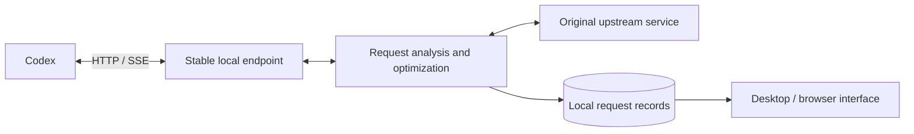

# ⚡ Codex Request Optimizer

[简体中文](https://github.com/qzz1008-glitch/codex-request-optimizer/blob/main/README.md) · **English**

A tool for **Windows x64 (64-bit)** that analyzes and optimizes Codex requests. Browse requests, token usage, and upload sizes by session, with lossless transport compression, request size protection, image handling, and automatic retries when a model is at capacity.

**[⬇️ Download for Windows x64](https://github.com/qzz1008-glitch/codex-request-optimizer/releases/latest)** · **[📖 User guide (Chinese)](https://github.com/qzz1008-glitch/codex-request-optimizer/blob/main/docs/usage.md)**

## ✨ Features

### 🔎 Session and request analysis

Browse request records by session to see what each request sent, how much space it used, and how it was handled.

- View session names, request times, models, response statuses, and elapsed times.
- Group image analysis, automatic titles, and similar auxiliary requests under their parent session. Regular subtasks keep separate rows with parent-child links; unidentified requests appear under “Other.”
- Show image information only for separate image-analysis sessions; regular sessions do not show it when carrying historical images or image paths.
- Check actual input/output token counts for requests; unavailable data is clearly marked.
- Switch between Records and Trends in the upper-right corner. Compare input tokens for all sessions on one live timeline, with markers for protection, retry, and compaction events.
- See how messages, tool outputs, reasoning content, and other parts contribute to request size.
- Explore structured request JSON, compare sizes before and after processing, and download a sanitized copy.
- Select and copy text, preserving valid selections during live updates and sorting.

### 🗜️ Lossless zstd transport compression

Reduce upload size while preserving the original content and meaning.

Choose from **compression levels 1–17** and compare compressed sizes and estimated local processing times. Requests already using zstd can also be recompressed; the new body is used only when it is smaller.

With request size protection enabled, use **automatic compression by packet size**. Smaller requests keep their original body; other requests automatically choose between fast level 1 and high-compression level 17 based on the session's upload sizes. Turning automatic mode off restores the manual level. See the user guide for the exact thresholds.

### 🧠 Context settings

Adjust the context window and automatic compaction threshold used by the Codex client, or restore the model defaults.

Context settings and request size protection are configured separately, so you can adjust each to suit your needs.

### 🛡️ Request size protection

For request body limits such as **1M (1,000,000 bytes)**, set a custom size limit and use two protection mechanisms:

- **Predictive protection**: when a request approaches the configured threshold, prompt Codex to run native context compaction earlier, helping prevent later requests from exceeding the limit.
- **Over-limit protection**: when a request is already too large, turn completed history into a handover summary, retain necessary instructions and recent content, and check the resulting request size again. Later requests can reuse the corresponding result.

### 🔁 Automatic retries when a model is at capacity

When an explicit model capacity error occurs, retry automatically according to your settings, keeping the same model and request content.

> Selected model is at capacity. Please try a different model.

### 🖼️ Image request optimization

Choose from **Native / Disabled / Optimized** image analysis modes. Native is the default.

- **Native**: use the native Codex image tool and uninstall the optimization tool installed by this application.
- **Disabled**: disable the native image tool and the separate image tool managed by this application.
- **Optimized**: save images locally and use their paths in the main request. A separate image analysis session returns text results, reducing the context occupied by images in the main session.

You can choose a custom image directory. Reload the Codex client after changing the image tool entry points.

---

## 🚀 Usage

### Download and setup

1. Download `CodexPacketInspector.exe` from **[Releases](https://github.com/qzz1008-glitch/codex-request-optimizer/releases/latest)**.
2. Double-click the EXE and follow the prompts to install and connect it.
3. Adjust context settings and enable the protection, retry, and image options you need.
4. Restart your Codex client after connecting for the first time or changing the entry port.

The release EXE includes both the interface and the background service; no Python environment is required. Release assets also include the README, project license, and third-party licenses.

### Everyday use

Use the desktop window or open the interface in a browser. The default browser address is:

**[http://127.0.0.1:47844/](http://127.0.0.1:47844/)**

The top bar switches between Disconnected, Analyze, and Optimize. Select a session on the left, browse requests in the middle, and view request information, size composition, request JSON, and changes on the right. JSON browsing supports search, path navigation, and downloading a sanitized copy.

Closing the desktop window keeps the application in the system tray. When exiting from the tray, you can restore the original upstream first or exit while keeping the relay configuration. The application stays running until active requests finish. Language selection and launch at sign-in are available in Settings.

### Settings and saving

Use Save at the bottom of Settings to apply changes and view the result of each step. Restore discards changes that have not yet been saved; Default beside a context setting restores the model default. Settings that require a Codex restart are identified separately.

### Online updates

Check for updates and upgrade from Settings. The application verifies the download, updates the desktop window and background service, and preserves existing records and settings.

During a normal update, new requests go to the new service while the old service finishes requests already in progress.

### Local data

The default data directory is:

```text
%USERPROFILE%\.codex-packet-inspector
```

Request records, settings, configuration backups, and image attachments are stored locally. See the **[user guide (Chinese)](https://github.com/qzz1008-glitch/codex-request-optimizer/blob/main/docs/usage.md)** for detailed instructions.

---

## ⚙️ How it works

### Request flow

The application uses the standard Codex **provider configuration** to route requests through a local HTTP endpoint, keeping track of the original upstream address, authentication method, and additional request headers.



The stable endpoint receives requests. The background service analyzes them, applies enabled optimizations, and forwards them to the original upstream service. Responses stream back to Codex, while the interface reads local records to display request details.

### Compression and protection

| Mechanism | Implementation |
| :--- | :--- |
| **Lossless transport compression** | Compress the upload body with zstd. Try recompressing existing zstd requests and compare sizes before deciding whether to replace the body. |
| **Predictive protection** | Assess risk from the encoded request size and raise the input token count in a successful response to prompt native Codex compaction. Actual upstream usage is saved separately for statistics. |
| **Over-limit protection** | Identify a suitable history prefix, generate a handover summary through a Responses request, rebuild the request, and check the upload size. |
| **Result reuse** | Cache history-prefix fingerprints and processing results by session. Reuse matching results and reassess when history or relevant settings change. |
| **Capacity retries** | Detect explicit capacity errors in HTTP or streaming responses and retry with the same model and request according to the settings. |

### Image handling and separate analysis

Image handling has two parts: saving local attachments and providing a separate image analysis tool.

When enabled, the relay saves embedded images as local attachments and uses their paths in the main request sent upstream. The EXE installs and registers a separate stdio MCP image tool; Codex launches it, analyzes images in an independent session, and returns text to the main session. The tool runs with Windows PowerShell and has its own installed files. The EXE installs, updates, and uninstalls it without hosting an image-tool HTTP endpoint or using tool hooks. Selecting Native uninstalls the image tool installed by this application and restores the native `view_image` tool.

Image optimization copies `codex-clipboard-*` images from the system temporary directory into `%TEMP%\CodexRequestOptimizer\` and uses the copy paths in the current request, retaining the originals. The copy cache is limited to 256 MiB; later image processing removes copies unused for more than seven days. If copying fails, the original path is retained.

### Usage and request records

Token usage is captured directly from successful upstream responses, independently of request size protection. Existing local Codex records are used only when older requests lack captured response usage. Usage displays no longer read or show token window limits or occupancy percentages. When data cannot be matched or has not yet been written, the interface shows an unavailable or pending state.

Request records and processing results are stored in **SQLite**. Sensitive authentication headers are forwarded without saving their values in captured records. Browsing and JSON downloads use sanitized copies.

### Desktop and background service

| Technology | Purpose |
| :--- | :--- |
| **Python** | Local HTTP service, request processing, and configuration management |
| **zstandard** | zstd compression and decompression of request bodies |
| **SQLite** | Request records and cached history-processing results |
| **HTML / CSS / JavaScript** | Three-column interface, request analysis, and Settings |
| **pywebview / WebView2** | Windows desktop window |
| **PyInstaller** | Single-file EXE builds |

The desktop window and relay service run in separate processes and communicate through a local API. During an update, the application starts and verifies the new background service before routing new requests to it. The old service exits after finishing its existing requests.

### Building and releases

The shared build entry point is:

```powershell
python -m scripts.build_inspector --mode release
```

The build freezes a complete source snapshot, records the Git commit and file fingerprints, and verifies embedded EXE resources and frontend content. Official releases use a clean, integrated `main` branch. If the source changes during a build, the build is discarded and must be repeated.

See **[development and builds (Chinese)](https://github.com/qzz1008-glitch/codex-request-optimizer/blob/main/docs/development.md)** for environment setup, frontend live updates, tests, and the build workflow.

---

## 📄 License

This is an independent third-party tool licensed under the **[MIT License](https://github.com/qzz1008-glitch/codex-request-optimizer/blob/main/LICENSE)**.

Third-party component notices and licenses are included in the release file `THIRD_PARTY_NOTICES.txt`.
