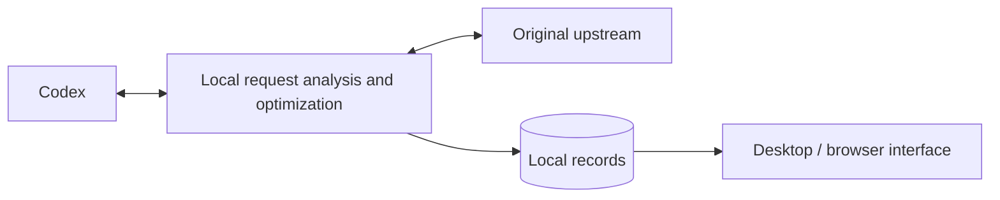

# ⚡ Codex Request Optimizer

[简体中文](https://github.com/qzz1008-glitch/codex-request-optimizer/blob/main/README.md) · **English**

A tool for Windows x64 (64-bit) that provides Codex session and request analysis, lossless transport compression, request size protection, image optimization, and automatic retries when a model is at capacity.

**[⬇️ Download](https://github.com/qzz1008-glitch/codex-request-optimizer/releases)** · **[📖 User guide](https://github.com/qzz1008-glitch/codex-request-optimizer/blob/main/docs/usage.md)**

## ✨ Features

### 🔎 Session and request analysis

Browse requests by session to understand what was sent, how much space it used, and the result.

- View session names, request times, models, results, total time, and error reasons.
- Check actual input and output token usage, with unavailable data clearly marked.
- Group image-analysis, automatic-title, and other auxiliary requests under their parent session. Show regular subtasks separately and collect unidentified requests under “Other.”
- Analyze the size of messages, tool outputs, reasoning, and other components, and compare successive requests in a session.
- Browse structured request JSON, search it, navigate to a path, and download a redacted copy.
- Select and copy text, with valid selections preserved across live refreshes and sorting.
- Right-click the tray icon to open a white panel showing connection status, retained request count / time range / session count, requests that triggered protection, and average input tokens before compaction; statistics follow retained records. During cold-start warmup, a native menu keeps the open-window and exit actions available.

### 📈 Trends and historical browsing

Use a shared timeline for request size and input tokens to follow session growth and protection events.

The request list and token chart show input tokens before overflow summarization: authentic usage when no summary was applied, or an estimate marked `≈` when it was. Estimates follow Codex's content-based heuristics. When the model, request settings, and input prefix match, authentic usage from an unreplaced request anchors the estimate of appended content. The details pane retains actual upstream usage after summarization; unavailable estimates show “—”.

- Start with a **one-hour** span after idle periods are shortened, and zoom between **1 and 12 hours**; points retain their actual timestamps.
- Pan with the mouse wheel, zoom around the cursor with Ctrl + wheel, or drag the time slider to browse history.
- Keep your position while browsing history; return to the right edge to follow new requests.
- Skip most of each long idle interval while keeping curves connected; timeline markers show the skipped periods and their actual start and end times on hover, with both charts aligned.
- Distinguish sessions by color and identify predictive protection, overflow protection, retry protection, and native context compaction with event markers.
- Search for sessions, locate their series, inspect requests on hover, and highlight matching nodes through the mechanism legend.

### 🗜️ Lossless zstd transport compression

Reduce request upload size while preserving the original content and meaning.

- Losslessly compress conversation requests and JSON image generation/edit requests while preserving image content and quality. The request list and filters distinguish these three operations.
- Set separate compression levels for conversation and image requests. Images default to **level 6**; smart mode always uses the offline-selected **level 6**, while manual mode uses the selected image level. Runtime requests do not probe different levels.
- With request size protection enabled, reference images are downscaled if transport compression still leaves an image request over the limit. This can reduce detail; disabling protection leaves only lossless transport compression. Original files and transparency are preserved, with at most two passes from the originals and support for explicitly identified edit masks.
- Choose from **compression levels 1–22**, with compressed-size and local processing-time estimates to help compare them.
- View separate estimates for original requests below 1.5 MB and those at or above 1.5 MB, with colors showing relative results within each group.
- Further optimize existing zstd requests, replacing them only when the compressed body is smaller.
- With request size protection enabled, use **automatic compression by request size**: keep small requests unchanged, select fast or high compression for larger requests, and leave high compression when requests return to the small-body range.
- Inspect original and forwarded request sizes, reduction, encoding, and compression level. See the user guide for measurement definitions and automatic selection rules.

### 🧠 Context settings

Adjust the context window and automatic compaction threshold used by Codex, or restore model defaults. Configure context settings separately from request size protection to suit your workflow.

### 🛡️ Request size protection

Protect against gateway rejection caused by oversized request bodies under **1M (1,000,000-byte) and similar limits**. Set a custom size limit and use two protection mechanisms:

- **Predictive protection**: encourage native Codex context compaction as requests approach the limit, leaving room for subsequent requests.
- **Overflow protection**: turn completed history into a handoff summary while retaining essential instructions and recent content, then forward the smaller request. Later requests can reuse the result.

The request list, details, and trends show which protections were triggered and their status.

### 🔁 Automatic retries when a model is at capacity

For the following capacity error, provide wait information to Codex so it can wait, retry, and continue the current step:

> Selected model is at capacity. Please try a different model.

- Set **1–99 retries**, with a default of **15**.
- Set a wait of **1–99 seconds**, with a default of **30 seconds**; longer upstream waits take precedence.
- Keep text and tool calls streaming.
- Reload Codex configuration after changing the retry count, following the restart prompt in the app.

“Retry protection triggered” means wait information was provided to Codex; Codex performs the actual retries.

### 🖼️ Image request optimization

Choose **Native / Disabled / Optimized**, with Native as the default.

- **Native**: use the native Codex image tool.
- **Disabled**: turn off native image analysis and image-analysis tools managed by this app.
- **Optimized**: replace inline images in user messages and tool results in the main request with local paths, preserving tool-call relationships and other content. An image-analysis tool in a separate session returns text results, reducing the images' impact on the main session's context.

Choose a custom image folder if needed. After switching image tools, follow the prompt to reload the Codex client.

---

### 🤝 LAN sharing

- A separate Sharing tab, off by default, leaves the existing records and trends views intact.
- Share local quota and Share local exit are enabled separately and generate separate links. Multiple people can use one quota source or one exit. Local quota and local networking are the default, with no account pool to maintain.
- Each computer can borrow from at most one quota source and select one network exit. Replacing a quota or exit link replaces the current source; failed validation preserves the previous selection. Quota lending and borrowing are mutually exclusive across instances, ports and data directories. Lending only uses local native authorization and cannot re-lend someone else's quota. Process exit releases the machine-wide guard.
- Install this app on the participating computers. Providers choose their LAN address and start the desired sharing. Borrowers paste a `codex-share://` link under Quota source, and select an exit or paste a `codex-exit://` link under Network exit. Borrowing only an exit keeps using your own quota and requires the main page to remain connected.
- Borrowed quota can use the quota provider's physical exit, the borrower's physical exit, or a third-party shared exit. Selecting your own exit automatically creates a callback tunnel, without copying your own link. Generation, native compact, overflow summaries and isolated image analysis use the same quota and exit; changing settings during request preparation does not alter that request's route.
- A shared exit always uses its own network and system proxy, ignoring any other shared exit selected by that computer. You can consume someone else's exit while providing your physical exit to multiple people; mutual selections cannot form forwarding chains. Exits only accept CONNECT tunnels to official Codex HTTPS upstreams, retain end-to-end upstream TLS, do not decrypt conversations, access upstream credentials or read tokens, and count only encrypted bytes and connections. Upload permission above 1 MB depends on the actual exit network's policy.
- The quota provider's Codex manages and renews upstream authorization; it is never written to the borrower's configuration. Quota and exit links remain in memory and sharing does not resume automatically after restarting. HTTPS connections verify the certificate fingerprint in the link before sending a grant, without installing certificates.
- Quota providers handle native authorization, expiration, forwarded request limits and an optional cumulative token limit. New requests are rejected once a limit is reached; started requests may finish, so concurrent requests can exceed the token limit. Request counts include compaction and image analysis, do not represent official credits, and exclude model catalog queries. Links can be replaced or sharing stopped at any time; sharing stops on app exit. Started requests or exit tunnels may finish after stopping or rotating a link, but the old link cannot open new requests or tunnels.
- Borrowers handle tools, images, transport compression, predictive protection, overflow summaries, native retries and local request records; quota providers do not repeat compression, protection or retries. Connection or exit failures return errors without automatically switching accounts or exits. Manually stopping a local callback exit explicitly switches back to the quota provider's exit.
- Quota providers' shared traffic bypasses local capture and is excluded from their request records, charts, retry diagnostics and network diagnostics. Only authentic input, cached-input and output token totals for the sharing session are kept in memory. Cached input is already included in input; usage rewritten by the borrower's predictive protection is not counted. Requests without usage are counted separately without inventing tokens. Totals remain visible after stopping, and reset when sharing restarts or the app exits.
- The Pro $200/month subscription has no published fixed token allowance; accumulated tokens cannot determine remaining subscription usage. The interface links to [official usage information](https://learn.chatgpt.com/docs/pricing) for reference.
- Both sides must support the updated protocol with independent quota and exit sharing. Older providers are rejected before the borrower's configuration is modified.
- Disconnecting restores provider selections in the main configuration, active profile and isolated-image profile while preserving unrelated edits. Reload Codex configuration for changes to take effect; existing chats may retain their previous connection.
- Participating computers need reachable LAN connectivity and firewall access to the sharing ports. For automatic callbacks the quota provider must also be able to connect to the borrower. Quota entries accept only model requests and model catalog queries; exit entries accept only restricted encrypted tunnels. Neither exposes local settings or history. Quota providers forward request content in memory; share only with trusted colleagues.

## 🚀 Usage

### Download and setup

1. Download `CodexPacketInspector.exe` from **[Releases](https://github.com/qzz1008-glitch/codex-request-optimizer/releases)**.
2. Run it and follow the prompts to install and connect.
3. Adjust context settings and enable the protection, retry, and image features you need.
4. Restart the Codex client after connecting for the first time or changing the entry port.

The release EXE includes the interface and background service; no separate Python setup is required.

### Everyday use

- Use **Disconnect / Connect** in the title bar to control the connection. Disconnect restores the original upstream; Connect routes requests through this app.
- Select a session on the left, browse requests in the middle, and inspect request information, size composition, JSON, and changes on the right. Switch between records and trends in the title bar.
- Closing the window keeps the app in the system tray. When exiting, the app waits for in-flight requests to finish. Change the language and login-startup option in Settings.
- Use the desktop window or a browser. The default browser address is **[http://127.0.0.1:47844/](http://127.0.0.1:47844/)**.

### Settings and saving

Click **Save** at the bottom to apply settings. **Restore** discards unsaved changes, while **Default** next to a context setting restores its model default. Settings that require a Codex restart are marked separately.

Language changes are previewed immediately and remembered after **Save**. **Restore** or closing unsaved settings cancels the preview. Session names and original request and response content stay unchanged.

**Storage locations** groups the log folder, cache folder, and image save folder. The cache folder holds request records and context-summary caches. Log and cache folder changes take effect on the next launch of this app; existing data remains in its original folder. The image folder applies to newly saved images. Configuration and upgrade information continue to use the original data directory, and upgrades preserve these folder settings.

### Connection and error diagnostics

Each click on **Connect** records configuration changes, runtime information, and proxy sources, then runs bounded background DNS and TCP-port checks for the relevant destinations. Installation, upgrades, and startup do not trigger probes, and successful requests do not add diagnostic records.

Before connecting, the app checks Windows proxy exclusions for local addresses and appends missing `127.0.0.1`, `localhost`, and `[::1]` entries. It also repairs local exclusions where environment proxies or `NO_PROXY` are already used. Existing proxy addresses, other exclusions, and PAC settings are preserved without expanding direct access to other sites. Repairs prompt a ChatGPT App restart. A failed check or repair stops the connection attempt; diagnostics retain before/after values and error details. Reconnecting does not repeat unchanged writes. Installation, upgrades, startup, and disconnection do not trigger repairs.

Failed requests record the actual connection destination, proxy CONNECT/TLS/upload/response-wait phases, byte counts, status, related request ID, necessary response headers, and redacted error details. HTML gateway errors retain readable text, with long content truncated to a limit. Stream errors and local request-protection failures are also recorded. Diagnostics do not save normal conversation output or request bodies, replay inference requests, change proxy selection, or broaden retry handling.

Diagnostics are saved as `network-diagnostics.sqlite` in the selected log folder. View the file with a SQLite tool, or retrieve it directly for troubleshooting. Diagnostic records are limited to 14 days, 500 entries, and 16 MiB of record content, with cleanup on connection or new error records. Missing historical information cannot be reconstructed. Diagnostic write failures do not interrupt forwarding.

To check proxies and the 1 MB upload limit on another PC, copy the standalone [Test-CodexNetwork.cmd](../scripts/windows/Test-CodexNetwork.cmd) and double-click it. Python and administrator privileges are not required. It checks direct and proxied access to the local entry, then sends synthetic 64 kB, 950 kB, and 1,100 kB samples upstream (1 kB = 1,000 bytes). It does not change configuration, send Codex login credentials, or invoke a model. Results and redacted error bodies are saved in a timestamped folder beside the script. An API rejection is only evidence that this sample showed no gateway block; it does not replace formal upload-permission approval.

To inspect session providers and configuration sources, copy [Collect-CodexRouting.cmd](../scripts/windows/Collect-CodexRouting.cmd), keep ChatGPT running, and double-click the script. It uses native read-only APIs to extract recent session providers and current on-disk configuration layers, and records routing overrides visible in process startup arguments. It excludes conversation bodies, authentication values, and complete MCP environments, and sends no messages or model requests. Results are saved in a `CodexConfigReport-*` folder beside the script. The collector starts a separate diagnostic process; its results do not represent the existing window's in-memory configuration. Existing process arguments are not replayed, and native startup may generate its own logs or cache.

### Online updates

Check for updates in Settings, or download and run the new EXE. Upgrades preserve records, settings, and the installed development or release mode. The new service handles new requests while the previous service finishes requests already in progress.

Release assets contain only the formal EXE, README, project license, and third-party notices.

### Local data and privacy

Default data directory:

```text
%USERPROFILE%\.codex-packet-inspector
```

- Request records, settings, configuration backups, and image attachments stay on your machine.
- Authentication headers are forwarded, but their values are not saved in captured records. JSON browsing and downloads use redacted copies.
- Retain up to **500 MB / 2,000 requests** by default, adjustable in Record Settings.
- Reclaim older details first to preserve basic records, actual usage, and trend data where possible. Remove old records when necessary. Reclaimed details cannot be restored.
- Sizes use decimal units: 1 KB = 1,000 bytes and 1 MB = 1,000,000 bytes. The interface reports stored record-content usage.

See the **[user guide](https://github.com/qzz1008-glitch/codex-request-optimizer/blob/main/docs/usage.md)** for detailed operation and configuration.

---

## ⚙️ Implementation overview

Use standard Codex **provider configuration** to route requests through a local relay for analysis, compression, and protection before forwarding them to the original upstream. Responses stream back to the client.



The local service uses **Python**, transport compression uses **zstd**, and request records are stored in **SQLite**. HTML / CSS / JavaScript provide the interface, with **pywebview / WebView2** supplying the Windows desktop window. Image analysis runs through a separate tool and session.

Token usage comes from actual upstream responses when available, with read-only fallback to existing local Codex records. Unconfirmed data remains marked as unavailable.

---

## 📄 License

This is an independent third-party tool released under the **[MIT License](https://github.com/qzz1008-glitch/codex-request-optimizer/blob/main/LICENSE)**.

Third-party component notices and licenses are included in `THIRD_PARTY_NOTICES.txt` with the release.
