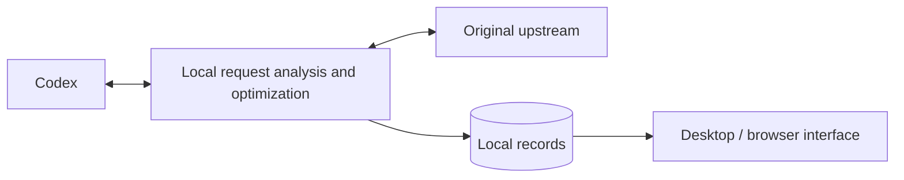

# ⚡ Codex Request Optimizer

[简体中文](https://github.com/qzz1008-glitch/codex-request-optimizer/blob/main/README.md) · **English**

A tool for Windows x64 (64-bit) that provides Codex session and request analysis, lossless transport compression, request size protection, image optimization, and automatic retries when a model is at capacity.

**[⬇️ Download](https://github.com/qzz1008-glitch/codex-request-optimizer/releases)** · **[📖 User guide](https://github.com/qzz1008-glitch/codex-request-optimizer/blob/main/docs/usage.md)**

## ✨ Features

### 🔎 Session and request analysis

Browse requests by session to understand what was sent, how much space it used, and the result.

- View session names, request times, models, results, total time, and error reasons.
- Check actual input and output token usage, with unavailable data clearly marked.
- Group image-analysis, automatic-title, and other auxiliary requests under their parent session. Show regular subtasks separately and collect unidentified requests under “Other.”
- Analyze the size of messages, tool outputs, reasoning, and other components, and compare successive requests in a session.
- Browse structured request JSON, search it, navigate to a path, and download a redacted copy.
- Select and copy text, with valid selections preserved across live refreshes and sorting.
- Check connection status, retained request count, requests that triggered protection, and average input tokens before compaction from the tray menu; statistics follow retained records.

### 📈 Trends and historical browsing

Use a shared timeline for request size and input tokens to follow session growth and protection events.

- Start with the last **hour** and zoom to a **1–12-hour** viewing range.
- Pan with the mouse wheel, zoom around the cursor with Ctrl + wheel, or drag the time slider to browse history.
- Keep your position while browsing history; return to the right edge to follow new requests.
- Distinguish sessions by color and identify predictive protection, overflow protection, retry protection, and native context compaction with event markers.
- Search for sessions, locate their series, inspect requests on hover, and highlight matching nodes through the mechanism legend.

### 🗜️ Lossless zstd transport compression

Reduce request upload size while preserving the original content and meaning.

- Choose from **compression levels 1–22**, with compressed-size and local processing-time estimates to help compare them.
- View separate estimates for original requests below 1.5 MB and those at or above 1.5 MB, with colors showing relative results within each group.
- Further optimize existing zstd requests, replacing them only when the compressed body is smaller.
- With request size protection enabled, use **automatic compression by request size**: keep small requests unchanged, select fast or high compression for larger requests, and leave high compression when requests return to the small-body range.
- Inspect original and processed sizes, reduction, encoding, and compression level. See the user guide for measurement definitions and automatic selection rules.

### 🧠 Context settings

Adjust the context window and automatic compaction threshold used by Codex, or restore model defaults. Configure context settings separately from request size protection to suit your workflow.

### 🛡️ Request size protection

Protect against gateway rejection caused by oversized request bodies under **1M (1,000,000-byte) and similar limits**. Set a custom size limit and use two protection mechanisms:

- **Predictive protection**: encourage native Codex context compaction as requests approach the limit, leaving room for subsequent requests.
- **Overflow protection**: turn completed history into a handoff summary while retaining essential instructions and recent content, then forward the smaller request. Later requests can reuse the result.

The request list, details, and trends show which protections were triggered and their status.

### 🔁 Automatic retries when a model is at capacity

For the following capacity error, provide wait information to Codex so it can wait, retry, and continue the current step:

> Selected model is at capacity. Please try a different model.

- Set **1–99 retries**, with a default of **15**.
- Set a wait of **1–99 seconds**, with a default of **30 seconds**; longer upstream waits take precedence.
- Keep text and tool calls streaming.
- Reload Codex configuration after changing the retry count, following the restart prompt in the app.

“Retry protection triggered” means wait information was provided to Codex; Codex performs the actual retries.

### 🖼️ Image request optimization

Choose **Native / Disabled / Optimized**, with Native as the default.

- **Native**: use the native Codex image tool.
- **Disabled**: turn off native image analysis and image-analysis tools managed by this app.
- **Optimized**: replace image content in the main request with local paths. An image-analysis tool in a separate session returns text results, reducing the images' impact on the main session's context.

Choose a custom image folder if needed. After switching image tools, follow the prompt to reload the Codex client.

---

## 🚀 Usage

### Download and setup

1. Download `CodexPacketInspector.exe` from **[Releases](https://github.com/qzz1008-glitch/codex-request-optimizer/releases)**.
2. Run it and follow the prompts to install and connect.
3. Adjust context settings and enable the protection, retry, and image features you need.
4. Restart the Codex client after connecting for the first time or changing the entry port.

The release EXE includes the interface and background service; no separate Python setup is required.

### Everyday use

- Use **Disconnect / Connect** in the title bar to control the connection. Disconnect restores the original upstream; Connect routes requests through this app.
- Select a session on the left, browse requests in the middle, and inspect request information, size composition, JSON, and changes on the right. Switch between records and trends in the title bar.
- Closing the window keeps the app in the system tray. When exiting, the app waits for in-flight requests to finish. Change the language and login-startup option in Settings.
- Use the desktop window or a browser. The default browser address is **[http://127.0.0.1:47844/](http://127.0.0.1:47844/)**.

### Settings and saving

Click **Save** at the bottom to apply settings. **Restore** discards unsaved changes, while **Default** next to a context setting restores its model default. Settings that require a Codex restart are marked separately.

### Online updates

Check for updates in Settings, or download and run the new EXE. Upgrades preserve records, settings, and the installed development or release mode. The new service handles new requests while the previous service finishes requests already in progress.

Release assets contain only the formal EXE, README, project license, and third-party notices.

### Local data and privacy

Default data directory:

```text
%USERPROFILE%\.codex-packet-inspector
```

- Request records, settings, configuration backups, and image attachments stay on your machine.
- Authentication headers are forwarded, but their values are not saved in captured records. JSON browsing and downloads use redacted copies.
- Retain up to **500 MB / 2,000 requests** by default, adjustable in Record Settings.
- Reclaim older details first to preserve basic records, actual usage, and trend data where possible. Remove old records when necessary. Reclaimed details cannot be restored.
- Sizes use decimal units: 1 KB = 1,000 bytes and 1 MB = 1,000,000 bytes. The interface reports stored record-content usage.

See the **[user guide](https://github.com/qzz1008-glitch/codex-request-optimizer/blob/main/docs/usage.md)** for detailed operation and configuration.

---

## ⚙️ Implementation overview

Use standard Codex **provider configuration** to route requests through a local relay for analysis, compression, and protection before forwarding them to the original upstream. Responses stream back to the client.



The local service uses **Python**, transport compression uses **zstd**, and request records are stored in **SQLite**. HTML / CSS / JavaScript provide the interface, with **pywebview / WebView2** supplying the Windows desktop window. Image analysis runs through a separate tool and session.

Token usage comes from actual upstream responses when available, with read-only fallback to existing local Codex records. Unconfirmed data remains marked as unavailable.

---

## 📄 License

This is an independent third-party tool released under the **[MIT License](https://github.com/qzz1008-glitch/codex-request-optimizer/blob/main/LICENSE)**.

Third-party component notices and licenses are included in `THIRD_PARTY_NOTICES.txt` with the release.
