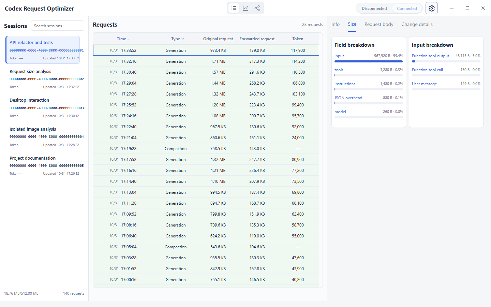
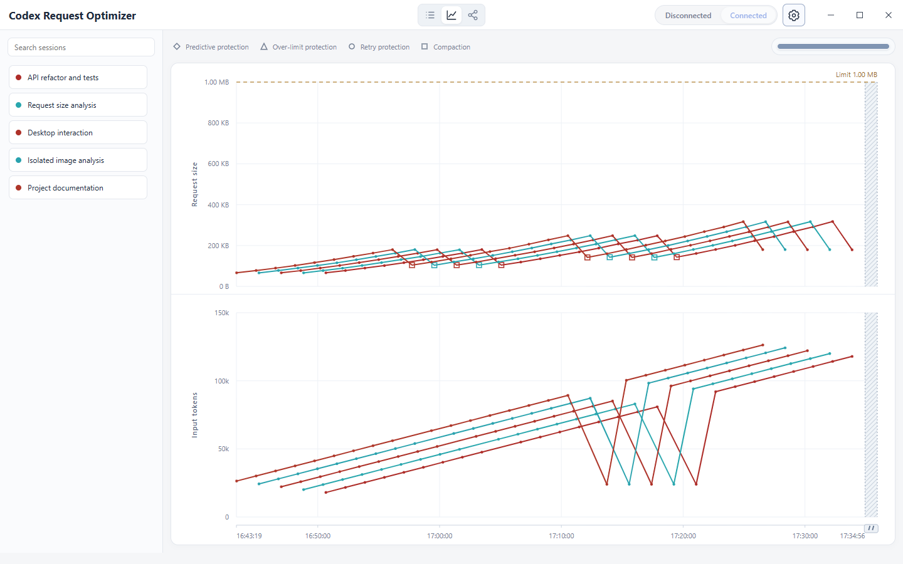
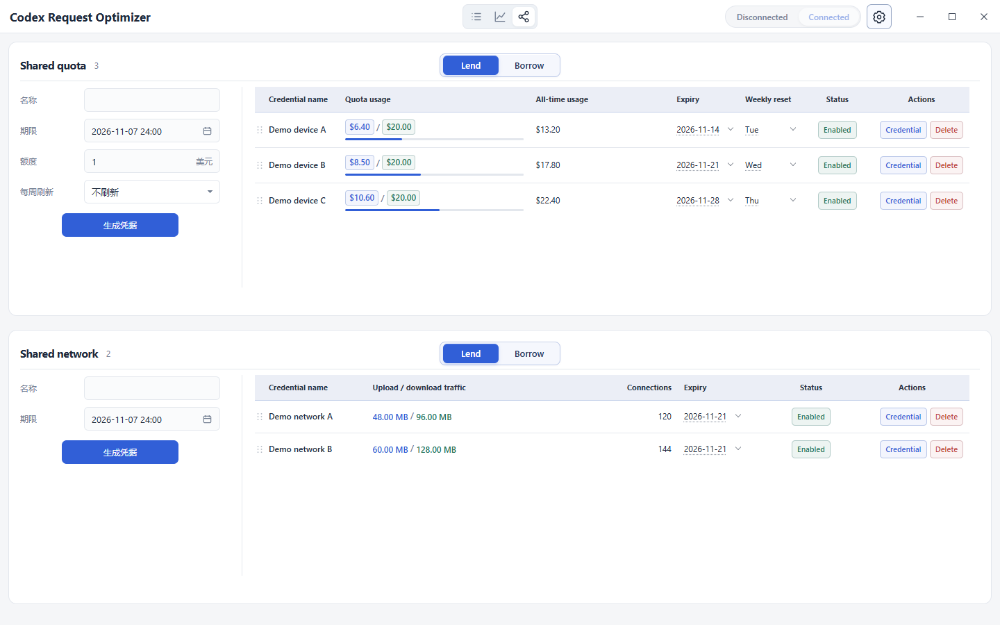
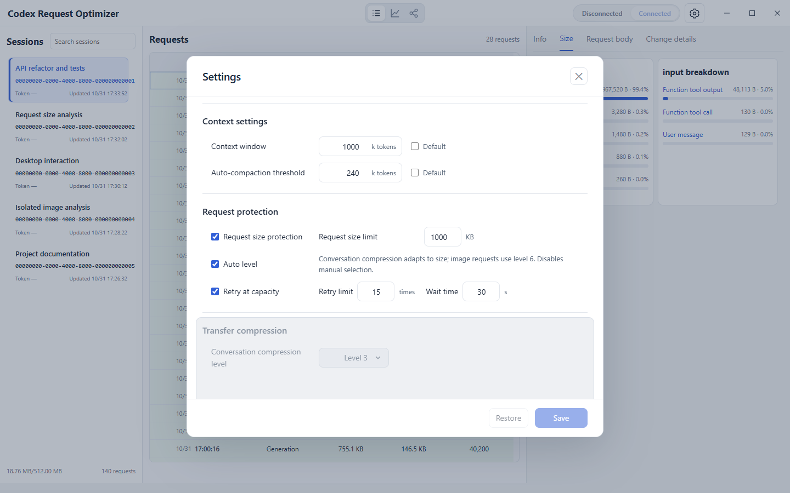

# ⚡ Codex Request Optimizer

[简体中文](https://github.com/qzz1008-glitch/codex-request-optimizer/blob/main/README.md) · **English**

A local request analysis and optimization tool for Codex on Windows x64 (64-bit). Reduce upload sizes through compression and fit more conversation context within the same request size limit.

**[⬇️ Download](https://github.com/qzz1008-glitch/codex-request-optimizer/releases)** · **[📖 Usage guide](https://github.com/qzz1008-glitch/codex-request-optimizer/blob/main/docs/usage.md)**

## ✨ Features

- **🗜️ Lossless compression**: reduce upload sizes for conversations, image generation, and image editing while retaining their content. Choose automatic compression or a manual level.
- **🛡️ Size protection**: control request size with a configurable limit. Predictive protection triggers context compaction early; overflow protection condenses history before forwarding.
- **🧠 Context settings**: adjust the context window and automatic compaction threshold, or restore model defaults.
- **🖼️ Image optimization**: choose Native, Disable, or Optimize mode. Optimization uses a separate analysis session to reduce image content in the main context. Size protection can also downscale oversized image requests, which may lose detail.
- **🔁 Capacity retries**: let Codex wait and retry automatically when a model is at capacity. Set the retry count and delay.
- **🔁 Request error retries**: optionally intercept a generic 400 containing only `Bad Request` and make 1–9 additional attempts in the relay. Disabled by default, with three retries when enabled; field and parameter errors pass through unchanged.
- **🔎 Analysis and trends**: inspect request sizes, token usage, errors, and redacted JSON by session. View trends, request changes, and protection events.
- **🤝 LAN sharing**: lend or borrow Codex quota and network exits independently. Manage credentials, expiry, reference spending limits, and weekly resets.

Capacity retries handle: `Selected model is at capacity. Please try a different model.`

## 🖼️ Interface previews

These previews use the real frontend with fictional sample data.

📈 Trend analysis

🤝 Quota and network sharing

⚙️ Context, protection, and compression settings

## 🚀 Usage

1. Download `CodexPacketInspector.exe` from [Releases](https://github.com/qzz1008-glitch/codex-request-optimizer/releases) and run it to install. No Python setup is needed.
2. Click Connect and adjust compression, protection, and image options in Settings.
3. Restart your Codex client when prompted. Later, check for updates in Settings or run a newer EXE to upgrade.

Includes Chinese/English language switching, tray operation, and start on login. Upgrades preserve records and settings, automatically synchronize existing connections, and clearly prompt when a restart or attention is needed.

On Windows and Linux, choose automatic detection or manual configuration under Outbound proxy in Settings. Automatic mode shows the detected source, HTTP/HTTPS addresses, and bypass list. Manual mode has separate address, username, password, and bypass fields. Saved changes apply to new requests without a restart. Usernames may be stored in plaintext; passwords are encrypted and never shown. Test proxy checks unsaved settings without sending conversations or Codex account credentials.

Existing Codex configurations in WSL can also be connected as a validation feature. See the [usage guide](https://github.com/qzz1008-glitch/codex-request-optimizer/blob/main/docs/usage.md) for sharing, WSL, and other detailed instructions.

## 🐧 Linux server build (under validation)

Build the Linux package on its target Linux environment using the same entry point: `python -m scripts.build_inspector --release-only`. Validation currently targets EulerOS 3.0 x86_64; provenance records include the architecture and glibc version. A Windows EXE cannot run as a Linux application.

Extract `CodexPacketInspector-linux-x86_64.tar.gz` and run `./CodexPacketInspector --background --ui-forward-port 47848`; no Python installation is needed. The relay and management interface listen only on `127.0.0.1:47844` by default. Access the browser interface through an SSH tunnel, for example `ssh -N -L 47848:127.0.0.1:47844 user@server`, then open `http://127.0.0.1:47848/` locally and click Connect. The tunnel port must match `--ui-forward-port`; this option does not change the Codex relay address. Connecting backs up the server's Codex configuration; reload or restart existing Codex processes when prompted.

The Linux build supports HTTP forwarding, zstd, request size protection, request records, and trends. Native image analysis remains available, and image tools can also be disabled. Windows tray integration, desktop windows, EXE automatic updates, and the PowerShell isolated image optimization tool are not enabled in the Linux package. Automatic proxy detection reads the service process's environment variables; manual configuration is also available in settings. No proxy address is built in. A sample systemd user service is included; see the [usage guide](https://github.com/qzz1008-glitch/codex-request-optimizer/blob/main/docs/usage.md#linux-服务器版) for details.

## ⚙️ Implementation overview

- **Connection and forwarding**: Codex's standard provider configuration routes requests through a local Python relay. Processed requests continue to the original upstream service. Connecting or upgrading checks and unifies compatible legacy chat provider settings while preserving conversation content.
- **Compression and protection**: zstd provides lossless transport compression. Actual upload size determines whether predictive or overflow protection is triggered to control request size.
- **Image analysis**: Codex manages a separate image tool through standard MCP stdio. Each call starts a fresh ephemeral conversation, returns text only, and cleans up temporary data afterward.
- **Interface and records**: WebView2 provides the desktop interface, while SQLite stores request records locally. Captured records omit authentication values; JSON views and downloads use redacted copies.

## 📄 License

This is an independent third-party tool released under the **[MIT License](https://github.com/qzz1008-glitch/codex-request-optimizer/blob/main/LICENSE)**. Third-party component licenses are included in `THIRD_PARTY_NOTICES.txt` with the release.
