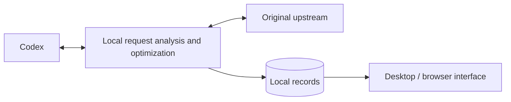

# ⚡ Codex Request Optimizer

[简体中文](https://github.com/qzz1008-glitch/codex-request-optimizer/blob/main/README.md) · **English**

A tool for Windows x64 (64-bit) that provides Codex session and request analysis, lossless transport compression, request size protection, image optimization, and automatic retries when a model is at capacity.

**[⬇️ Download](https://github.com/qzz1008-glitch/codex-request-optimizer/releases)** · **[📖 User guide](https://github.com/qzz1008-glitch/codex-request-optimizer/blob/main/docs/usage.md)**

## ✨ Features

### 🔎 Session and request analysis

Browse requests by session to understand what was sent, how much space it used, and the result.

- View session names, request times, models, results, total time, and error reasons.
- Check actual input and output token usage, with unavailable data clearly marked.
- Group image-analysis, automatic-title, and other auxiliary requests under their parent session. Show regular subtasks separately and collect unidentified requests under “Other.”
- Analyze the size of messages, tool outputs, reasoning, and other components, and compare successive requests in a session.
- Browse structured request JSON, search it, navigate to a path, and download a redacted copy.
- Select and copy text, with valid selections preserved across live refreshes and sorting.
- Right-click the tray icon to open a white panel showing connection status, retained request count / time range / session count, requests that triggered protection, and average input tokens before compaction; statistics follow retained records. During cold-start warmup, a native menu keeps the open-window and exit actions available.

### 📈 Trends and historical browsing

Use a shared timeline for request size and input tokens to follow session growth and protection events.

The request list and token chart show input tokens before overflow summarization: authentic usage when no summary was applied, or an estimate marked `≈` when it was. Estimates follow Codex's content-based heuristics. When the model, request settings, and input prefix match, authentic usage from an unreplaced request anchors the estimate of appended content. The details pane retains actual upstream usage after summarization; unavailable estimates show “—”.

- Start with a **one-hour** span after idle periods are shortened, and zoom between **1 and 12 hours**; points retain their actual timestamps.
- Pan with the mouse wheel, zoom around the cursor with Ctrl + wheel, or drag the time slider to browse history.
- Keep your position while browsing history; return to the right edge to follow new requests.
- Skip most of each long idle interval while keeping curves connected; timeline markers show the skipped periods and their actual start and end times on hover, with both charts aligned.
- Distinguish sessions by color and identify predictive protection, overflow protection, retry protection, and native context compaction with event markers.
- Search for sessions, locate their series, inspect requests on hover, and highlight matching nodes through the mechanism legend.

### 🗜️ Lossless zstd transport compression

Reduce request upload size while preserving the original content and meaning.

- Losslessly compress conversation requests and JSON image generation/edit requests while preserving image content and quality. The request list and filters distinguish these three operations.
- Set separate compression levels for conversation and image requests. Images default to **level 6**; smart mode always uses the offline-selected **level 6**, while manual mode uses the selected image level. Runtime requests do not probe different levels.
- With request size protection enabled, reference images are downscaled if transport compression still leaves an image request over the limit. This can reduce detail; disabling protection leaves only lossless transport compression. Original files and transparency are preserved, with at most two passes from the originals and support for explicitly identified edit masks.
- Both conversation and image level pickers offer **compression levels 1–22**, with separate sampled estimates of size changes and single-compression durations in milliseconds.
- View separate estimates for original requests below 1.5 MB and those at or above 1.5 MB, with colors showing relative results within each group.
- Further optimize existing zstd requests, replacing them only when the compressed body is smaller.
- With request size protection enabled, use **automatic compression by request size**: keep small requests unchanged, select fast or high compression for larger requests, and leave high compression when requests return to the small-body range.
- Inspect original and forwarded request sizes, reduction, encoding, and compression level. See the user guide for measurement definitions and automatic selection rules.

### 🧠 Context settings

Adjust the context window and automatic compaction threshold used by Codex, or restore model defaults. Configure context settings separately from request size protection to suit your workflow.

### 🛡️ Request size protection

Protect against gateway rejection caused by oversized request bodies under **1M (1,000,000-byte) and similar limits**. Set a custom size limit and use two protection mechanisms:

- **Predictive protection**: encourage native Codex context compaction as requests approach the limit, leaving room for subsequent requests.
- **Overflow protection**: turn completed history into a handoff summary while retaining essential instructions and recent content, then forward the smaller request. Later requests can reuse the result.

The request list, details, and trends show which protections were triggered and their status.

### 🔁 Automatic retries when a model is at capacity

For the following capacity error, provide wait information to Codex so it can wait, retry, and continue the current step:

> Selected model is at capacity. Please try a different model.

- Set **1–99 retries**, with a default of **15**.
- Set a wait of **1–99 seconds**, with a default of **30 seconds**; longer upstream waits take precedence.
- Keep text and tool calls streaming.
- Reload Codex configuration after changing the retry count, following the restart prompt in the app.

“Retry protection triggered” means wait information was provided to Codex; Codex performs the actual retries.

### 🖼️ Image request optimization

Choose **Native / Disabled / Optimized**, with Native as the default.

- **Native**: use the native Codex image tool.
- **Disabled**: turn off native image analysis and image-analysis tools managed by this app.
- **Optimized**: replace inline images in user messages and tool results in the main request with local paths, preserving tool-call relationships and other content. An image-analysis tool in a separate session returns text results, reducing the images' impact on the main session's context.

Choose a custom image folder if needed. After switching image tools, follow the prompt to reload the Codex client.

---

### 🤝 LAN sharing

- A separate **Sharing** tab has a quota region above an exit region, each containing its configuration form and credential list. The **Borrow / Lend** tabs at the top of each region switch both its form and list, showing only credentials for the selected direction. The regions switch independently without changing the quota or exit actually in use. Quota rows show used amount / budget with a thin progress bar, plus all-time usage. Exit rows show upload / download traffic and connection count; the lists scroll independently. Drag a whole row using the handle beside its name; neighboring rows make room as it moves. Release to save; cancellation or a failed save restores the previous order. Both lists include name, expiry, status and actions for editing applicable budgets and expiry or enabling/disabling credentials. Disabling the last valid credential stops its lending service; enabling a saved credential resumes lending. Existing records and trends stay unchanged. Both parties install this app; no account pool is required.
- Enter a name and generate a credential. On success, it is copied to the clipboard automatically and the button briefly shows **Copied**; the page does not display its contents. Click **Credential** on the right to copy it again later. Names must be unique within each credential type across borrowing and lending, ignoring leading/trailing spaces and letter case. Names are checked immediately when generating or renaming a credential. Disabled and expired credentials still reserve their names; quota and exit credentials may share a name. If a credential is disabled, expired or out of budget for the current period, Codex displays the specific reason and what to do next. Each quota or exit credential binds on first use to one computer’s persistent client identity, not its IP address. That computer can reconnect, and the binding survives restarts and upgrades; another computer needs a separate credential of that type. Existing unbound quota and exit credentials bind on their first use after upgrading. Budgets, expiry and usage history are preserved.
- The expiry selector shows a local date and time to the minute, or **No expiry**, defaulting to one week ahead for a new credential. Open it to choose a date and time or set no expiry. Confirming in the creation form only updates the draft; confirming in a list saves the change. A newly set deadline must be at least one day away; no expiry remains available. Click a name, budget or expiry directly in the right-hand lists to change it, click an outgoing credential's status to enable or disable it, and choose a weekday or disable weekly reset in its own column. Credentials can be copied, and the used amount can be clicked to adjust current-period usage. Borrowed credentials allow only a local name change; the provider controls budgets, expiry and reset rules, and usage statistics reflect recorded activity. Existing configuration stays unchanged, including legacy deadlines and budgets that are left unedited. Changes apply to new requests; started requests and tunnels may finish. The provider must keep the app and sharing running.
- Every credential row has a delete action with a confirmation step. Deleting an outgoing credential revokes it and removes its local usage records; other credentials stay valid. Removing the last valid outgoing credential stops the corresponding sharing service, except when an internal exit callback still needs that service. Removing a borrowed credential deletes only its locally saved link and usage, without revoking the provider's credential. Deleting the active quota credential stops borrowing, restores the original connection and prompts you to reload Codex configuration or restart ChatGPT. Deleting the active exit switches to this computer’s exit. Deletion cannot be undone; other credentials' usage and configuration stay unchanged.
- Quota is measured as a USD reference cost estimated from authentic upstream input, cache reads, cache writes and output, using known model, service-tier and long-context rates. Reasoning tokens are already included in output. Unknown models, unknown cache-write categories and missing usage are marked separately without inventing charges. See [official API pricing](https://developers.openai.com/api/docs/pricing). This is not actual ChatGPT subscription billing or remaining balance; Pro at $200/month does not provide a $200 API balance.
- Each quota credential has a period budget in USD. New and changed budgets have a $1 minimum and default to $1. There is no token-count or forwarded-request-count limit. New requests are rejected at the accounted reference budget. In-flight requests or missing usage can cause overshoot or underestimation. Weekly reset has a separate row on the left and its own list column. Choose Monday through Sunday, or disable it. Enabled budgets reset at midnight on the selected day in the provider's local time. Existing enabled schedules remain on Monday; changing the day does not immediately clear current usage. Editing the used amount changes only the current period, preserving all-time and current-week statistics and the reset schedule. In-flight requests still add their actual cost when they finish; requests started before a weekly reset do not charge the new period.
- Borrowed quota and exit credentials remain in history, with one selected quota source and one selected network exit per machine. Borrowers can only view the provider's expiry and budget. Active sources sync periodically; inactive history shows its last synced values. Quota lending and borrowing are mutually exclusive across the entire machine. Lending uses only local native authorization and cannot re-lend borrowed quota. A replacement is verified first; failure preserves the existing source.
- Borrowed quota defaults to the borrower's local exit without requiring a separate exit credential. Selecting a borrowed exit credential uses that exit instead. A quota credential does not include the provider's exit; using it requires borrowing a separate exit credential from the provider. Local exits create an internal callback tunnel automatically. Generation, native compact, overflow summaries and image analysis share the selected quota and exit. Changes during request preparation do not change that request's route. Exit-only borrowing still uses local quota and requires the main page to remain connected.
- Shared exits always use their own physical network and system proxy, ignoring any personally selected shared exit. Even mutual exit selections cannot form a forwarding chain. Restricted CONNECT tunnels reach only official Codex HTTPS upstreams and preserve end-to-end upstream TLS. Exits count encrypted bytes and connections without reading conversations, upstream credentials or tokens. Upload permission above 1 MB depends on the exit's actual network policy.
- Borrowers handle tools, images, compression, predictive protection, overflow summaries, native retries and local records. Quota providers stream directly without repeating protection or retries. Shared traffic bypasses the provider's capture, existing charts, network diagnostics and retry diagnostics. The sharing ledger stores only per-credential aggregate and daily costs, tokens or traffic, never borrower request bodies, replies, tool results or chat metadata. Failures return errors without automatically switching accounts or exits.
- Upstream authorization is managed and renewed by the provider's Codex and is never stored in the borrower's configuration or sharing ledger. On Windows, saved app credentials, borrowed links, client identity and sharing TLS private keys are protected with the current user's DPAPI. Connections verify the link's certificate fingerprint before sending credentials, without installing certificates. Statistics and credential history survive app restarts. Exiting stops sharing; restarting does not automatically lend or borrow. Manual resumption can reuse saved credentials while the address and port remain reachable.
- The app selects the LAN address automatically. Quota and exit ports are configured in Settings and take effect the next time sharing starts, without interrupting existing connections. Paste a `codex-share://` or `codex-exit://` credential to save and use it. Both parties need the credential-management protocol; older protocols are rejected before changing the borrower's configuration.
- Disconnecting quota restores provider selections in the main configuration, active profile and isolated-image profile, preserving unrelated edits. Follow the prompt to reload Codex configuration or restart ChatGPT; existing chats may retain their old connection. Networks and firewalls must allow the sharing entry. Callback exits also require the quota provider to reach the borrower. Sharing entries do not expose local settings or request history. Quota providers forward bodies in memory; share only with trusted colleagues.

## 🚀 Usage

### Download and setup

1. Download `CodexPacketInspector.exe` from **[Releases](https://github.com/qzz1008-glitch/codex-request-optimizer/releases)**.
2. Run it and follow the prompts to install and connect.
3. Adjust context settings and enable the protection, retry, and image features you need.
4. Restart the Codex client after connecting for the first time or changing the entry port.

The release EXE includes the interface and background service; no separate Python setup is required.

### Everyday use

- Use **Disconnect / Connect** in the title bar to control the connection. Disconnect restores the original upstream; Connect routes requests through this app.
- Select a session on the left, browse requests in the middle, and inspect request information, size composition, JSON, and changes on the right. Switch between records and trends in the title bar.
- Closing the window keeps the app in the system tray. When exiting, the app waits for in-flight requests to finish. Change the language and login-startup option in Settings.
- Use the desktop window or a browser. The default browser address is **[http://127.0.0.1:47844/](http://127.0.0.1:47844/)**.

### Settings and saving

Click **Save** at the bottom to apply settings. **Restore** discards unsaved changes, while **Default** next to a context setting restores its model default. Settings that require a Codex restart are marked separately.

Language changes are previewed immediately and remembered after **Save**. **Restore** or closing unsaved settings cancels the preview. Session names and original request and response content stay unchanged.

**Storage locations** groups the log folder, cache folder, and image save folder. The cache folder holds request records and context-summary caches. Log and cache folder changes take effect on the next launch of this app; existing data remains in its original folder. The image folder applies to newly saved images. Configuration and upgrade information continue to use the original data directory, and upgrades preserve these folder settings.

### Connection and error diagnostics

Each click on **Connect** records configuration changes, runtime information, and proxy sources, then runs bounded background DNS and TCP-port checks for the relevant destinations. Installation, upgrades, and startup do not trigger probes, and successful requests do not add diagnostic records.

Before connecting, the app checks Windows proxy exclusions for local addresses and appends missing `127.0.0.1`, `localhost`, and `[::1]` entries. It also repairs local exclusions where environment proxies or `NO_PROXY` are already used. Existing proxy addresses, other exclusions, and PAC settings are preserved without expanding direct access to other sites. Connection, disconnection and proxy repair results appear in the follow-up dialog without taking space in the main page. Repairs prompt a ChatGPT App restart. A failed check or repair stops the connection attempt; diagnostics retain before/after values and error details. Reconnecting does not repeat unchanged writes. Installation, upgrades, startup, and disconnection do not trigger repairs.

Failed requests record the actual connection destination, proxy CONNECT/TLS/upload/response-wait phases, byte counts, status, related request ID, necessary response headers, and redacted error details. HTML gateway errors retain readable text, with long content truncated to a limit. Stream errors and local request-protection failures are also recorded. Diagnostics do not save normal conversation output or request bodies, replay inference requests, change proxy selection, or broaden retry handling.

Diagnostics are saved as `network-diagnostics.sqlite` in the selected log folder. View the file with a SQLite tool, or retrieve it directly for troubleshooting. Diagnostic records are limited to 14 days, 500 entries, and 16 MiB of record content, with cleanup on connection or new error records. Missing historical information cannot be reconstructed. Diagnostic write failures do not interrupt forwarding.

To check proxies and the 1 MB upload limit on another PC, copy the standalone [Test-CodexNetwork.cmd](../scripts/windows/Test-CodexNetwork.cmd) and double-click it. Python and administrator privileges are not required. It checks direct and proxied access to the local entry, then sends synthetic 64 kB, 950 kB, and 1,100 kB samples upstream (1 kB = 1,000 bytes). It does not change configuration, send Codex login credentials, or invoke a model. Results and redacted error bodies are saved in a timestamped folder beside the script. An API rejection is only evidence that this sample showed no gateway block; it does not replace formal upload-permission approval.

To inspect session providers and configuration sources, copy [Collect-CodexRouting.cmd](../scripts/windows/Collect-CodexRouting.cmd), keep ChatGPT running, and double-click the script. It uses native read-only APIs to extract recent session providers and current on-disk configuration layers, and records routing overrides visible in process startup arguments. It excludes conversation bodies, authentication values, and complete MCP environments, and sends no messages or model requests. Results are saved in a `CodexConfigReport-*` folder beside the script. The collector starts a separate diagnostic process; its results do not represent the existing window's in-memory configuration. Existing process arguments are not replayed, and native startup may generate its own logs or cache.

### Online updates

Check for updates in Settings, or download and run the new EXE. Upgrades preserve records, settings, and the installed development or release mode. The new service handles new requests while the previous service finishes requests already in progress.

Release assets contain only the formal EXE, README, project license, and third-party notices.

### Local data and privacy

Default data directory:

```text
%USERPROFILE%\.codex-packet-inspector
```

- Request records, settings, configuration backups, and image attachments stay on your machine.
- Authentication headers are forwarded, but their values are not saved in captured records. JSON browsing and downloads use redacted copies.
- Retain up to **500 MB / 2,000 requests** by default, adjustable in Record Settings.
- Reclaim older details first to preserve basic records, actual usage, and trend data where possible. Remove old records when necessary. Reclaimed details cannot be restored.
- Sizes use decimal units: 1 KB = 1,000 bytes and 1 MB = 1,000,000 bytes. The interface reports stored record-content usage.

See the **[user guide](https://github.com/qzz1008-glitch/codex-request-optimizer/blob/main/docs/usage.md)** for detailed operation and configuration.

---

## ⚙️ Implementation overview

Use standard Codex **provider configuration** to route requests through a local relay for analysis, compression, and protection before forwarding them to the original upstream. Responses stream back to the client.



The local service uses **Python**, transport compression uses **zstd**, and request records are stored in **SQLite**. HTML / CSS / JavaScript provide the interface, with **pywebview / WebView2** supplying the Windows desktop window. Image analysis runs through a separate tool and session.

Token usage comes from actual upstream responses when available, with read-only fallback to existing local Codex records. Unconfirmed data remains marked as unavailable.

---

## 📄 License

This is an independent third-party tool released under the **[MIT License](https://github.com/qzz1008-glitch/codex-request-optimizer/blob/main/LICENSE)**.

Third-party component notices and licenses are included in `THIRD_PARTY_NOTICES.txt` with the release.
