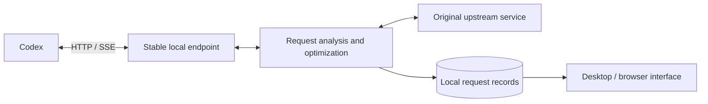

# ⚡ Codex Request Optimizer

[简体中文](https://github.com/qzz1008-glitch/codex-request-optimizer/blob/main/README.md) · **English**

A tool for Windows x64 (64-bit) that analyzes and optimizes Codex requests. Browse requests, token usage, and upload sizes by session, with lossless transport compression, request size protection, image handling, and automatic retries when a model is at capacity.

**[⬇️ Download](https://github.com/qzz1008-glitch/codex-request-optimizer/releases)** · **[📖 User guide (Chinese)](https://github.com/qzz1008-glitch/codex-request-optimizer/blob/main/docs/usage.md)**

## ✨ Features

### 🔎 Session and request analysis

- Response summaries: Request information shows up to 500 characters of visible reply text, tool names, the response ID, and the final state. Summaries are retained with requests, without a separate record limit.

Browse request records by session to see what each request sent, how much space it used, and how it was handled.

- View session names, request times, models, response statuses, and elapsed times.
- Group image analysis, automatic titles, and similar auxiliary requests under their parent session. Regular subtasks keep separate rows with parent-child links; unidentified requests appear under “Other.”
- Show image information only for separate image-analysis sessions; regular sessions do not show it when carrying historical images or image paths.
- Check actual input/output token counts for requests; unavailable data is clearly marked.
- Switch between Records and Trends at the top. The default range is the last **1 hour**. Zoom with the top-right slider or the chart's mouse wheel, from 1 hour up to the retained history, capped at 12 hours. The available range is established before zoom is enabled. History loads progressively in the background without shrinking the range when loading finishes. Find sessions on the left; packet sizes appear above input tokens on the right. Both charts share one timeline, use colors for sessions and marker shapes for protection and retry events, connect known points across missing values, and prioritize over-limit protection markers. Hover or keyboard-focus an event legend entry to highlight matching nodes and dim the rest, keeping each marker's session color. Packet sizes use the request list's Compressed column.
- See how messages, tool outputs, reasoning content, and other parts contribute to request size.
- Explore structured request JSON, compare sizes before and after processing, and download a sanitized copy.
- Select and copy text, preserving valid selections during live updates and sorting.

### 🗜️ Lossless zstd transport compression

Reduce upload size while preserving the original content and meaning.

Choose from **compression levels 1–22**, with compressed-size estimates shown separately for original requests below 1.5 MB and at least 1.5 MB, plus estimated local processing times. Requests already using zstd can also be recompressed; the new body is used only when it is smaller.

With request size protection enabled, use **automatic compression by packet size**. Smaller requests keep their original body. Without a saved phase, the original body's 1,500 KB threshold selects level 1 below it or level 16 at or above it. When a level-1 packet reaches the promotion threshold, the next request uses level 16 and stays there until the main request's uncompressed body is small again. Both levels apply predictive and overflow protection based on the actual compressed packet size. Turning automatic mode off restores the manual level. See the user guide for the exact thresholds.

Selection first uses the saved phase. If it is missing, metadata from the previous request for the same upstream and session can restore it, whether full details or only the summary remain. Neither request bodies nor cache expiry are required. Compressed size, encoding, and level in request details all describe the body before summary substitution; missing encoding or level in older records is shown as “—”.

### 🧠 Context settings

Adjust the context window and automatic compaction threshold used by the Codex client, or restore the model defaults.

Context settings and request size protection are configured separately, so you can adjust each to suit your needs.

### 🛡️ Request size protection

For request body limits such as **1M (1,000,000 bytes)**, set a custom size limit and use two protection mechanisms:

- **Predictive protection**: when a request approaches the configured threshold, prompt Codex to run native context compaction earlier, helping prevent later requests from exceeding the limit.
- **Over-limit protection**: when a request is already too large, turn completed history into a handover summary, retain necessary instructions and recent content, and check the resulting request size again. Later requests can reuse the corresponding result.

Predictive protection needs valid token usage in a completed response to finish the rewrite. It shows “Waiting for response” while pending and “Incomplete” if the response ends without completing it. When actual usage already meets the protection value, it shows “Already at threshold.” A successful overflow summary does not mean that response token usage has been rewritten.

### 🔁 Automatic retries when a model is at capacity

When enabled, the relay adds native `Retry-After` advice to explicit model capacity errors, allowing Codex to wait and continue the current step automatically. The relay does not wait, replay requests, or buffer complete responses. Text and tool calls continue streaming, and capacity errors after output has started can receive retry advice too.

Set 1–99 retries (default 15) and a wait of 1–99 seconds (default 30); longer upstream delays are honored. The count is written to the connected provider's standard `stream_max_retries`, with `request_max_retries` set to 0 to avoid an additional HTTP request retry budget. This native stream retry budget also applies to other retryable stream errors. Disabling the feature or disconnecting restores both original fields while preserving concurrent user edits.

Count changes require Codex to reload its configuration and do not update a step already running. Restarting ChatGPT/Codex ensures the new configuration is loaded. The toggle applies to new requests; wait time changes apply immediately to subsequent capacity errors on enabled requests. The count is a maximum; cancellation and non-retryable errors can still end a task.

Normal forwarding and overflow summaries use the same 300-second upstream read idle timeout, matching Codex's native default. Incoming response data allows a generation to continue without a total duration limit. Codex handles timeouts under its native rules; the relay does not retry requests itself.

“Native retry advice” in request details means wait information was sent to Codex, not that a native retry was observed. Actual retry records from older versions remain available. Background diagnostics are retained separately from request bodies: abnormal records for up to 30 days; ordinary successful requests for 24 hours, limited to 2,000 records. Automatic cleanup also applies a 20,000-record and ≈33.55 MB content budget. Logs contain only timestamps, settings, and structural events, without conversation text, tool content, or authentication data.

### 🖼️ Image request optimization

Choose from **Native / Disabled / Optimized** image analysis modes. Native is the default.

- **Native**: use the native Codex image tool and uninstall the optimization tool installed by this application.
- **Disabled**: disable the native image tool and the separate image tool managed by this application.
- **Optimized**: save images locally and use their paths in the main request. A separate image analysis session returns text results, reducing the context occupied by images in the main session.

Image settings manage tool installation and image replacement. The main page's Connect/Disconnect control manages all providers regardless of image mode. Separate image analysis sessions use the current connection without requiring a dedicated provider. You can choose a custom image directory. Reload the Codex client after changing the image tool entry points.

---

## 🚀 Usage

### Download and setup

1. Download `CodexPacketInspector.exe` from **[Releases](https://github.com/qzz1008-glitch/codex-request-optimizer/releases)**.
2. Double-click the EXE and follow the prompts to install and connect it.
3. Adjust context settings and enable the protection, retry, and image options you need.
4. Restart your Codex client after connecting for the first time or changing the entry port.

The release EXE includes both the interface and the background service; no Python environment is required. Release assets also include the README, project license, and third-party licenses.

### Everyday use

Use the desktop window or open the interface in a browser. The default browser address is:

**[http://127.0.0.1:47844/](http://127.0.0.1:47844/)**

The Disconnected / Connected toggle in the top bar controls the connection state. Connecting disables native Codex request compression and lets this app manage zstd using the selected level or automatic policy. Disconnecting restores the original upstream and enables native compression. Restart ChatGPT App when configuration changes require it.

Connections using Codex account authentication share the `OpenAI` name, and new sessions default to the stable `codex_packet_inspector` identifier. Old identifiers remain as compatibility entries without changing chat history. API key and other authentication configurations are preserved; their native compression support depends on Codex itself.

Select a session on the left, browse requests in the middle, and view request information, size composition, request JSON, and changes on the right. JSON browsing supports search, path navigation, and downloading a sanitized copy.

Closing the desktop window keeps the application in the system tray. When exiting from the tray, you can restore the original upstream first or exit while keeping the relay configuration. The application stays running until active requests finish. Language selection and launch at sign-in are available in Settings.

### Settings and saving

Use Save at the bottom of Settings to apply changes and view the result of each step. Restore discards changes that have not yet been saved; Default beside a context setting restores the model default. Settings that require a Codex restart are identified separately.

### Online updates

Check for updates and upgrade from Settings. The application verifies the download, updates the desktop window and background service, and preserves existing records and settings. Upgrades also refresh the tray and this application's shortcuts, preserve the login startup setting, and reclaim expired application copies.

During a normal update, new requests go to the new service while the old service finishes requests already in progress.

### Local data

The default data directory is:

```text
%USERPROFILE%\.codex-packet-inspector
```

Request records, settings, configuration backups, and image attachments are stored locally. See the **[user guide (Chinese)](https://github.com/qzz1008-glitch/codex-request-optimizer/blob/main/docs/usage.md)** for detailed instructions.

Sizes use decimal units: 1 KB = 1,000 bytes and 1 MB = 1,000,000 bytes. Upgrades preserve custom storage limits in bytes; migration of the old default is described below.

Request records default to limits of **500 MB / 2,000 records**, adjustable in Record settings. The left sidebar footer shows stored-record usage / the storage limit and the current request count. Usage measures record content rather than the entire data directory's disk footprint.

---

## ⚙️ How it works

### Request flow

The application uses the standard Codex **provider configuration** to route requests through a local HTTP endpoint, keeping track of the original upstream address, authentication method, and additional request headers.



The stable endpoint receives requests. The background service analyzes them, applies enabled optimizations, and forwards them to the original upstream service. Responses stream back to Codex, while the interface reads local records to display request details.

### Compression and protection

| Mechanism | Implementation |
| :--- | :--- |
| **Lossless transport compression** | Compress the upload body with zstd. Try recompressing existing zstd requests and compare sizes before deciding whether to replace the body. |
| **Predictive protection** | Assess risk from the encoded request size and raise the input token count in a successful response to prompt native Codex compaction. Actual upstream usage is saved separately for statistics. |
| **Over-limit protection** | Identify a suitable history prefix, generate a handover summary through a Responses request, rebuild the request, and check the upload size. |
| **Result reuse** | Cache history-prefix fingerprints and processing results by session. Reuse matching results and reassess when history or relevant settings change. |
| **Capacity retries** | Add wait advice to HTTP or streaming capacity errors so Codex retries natively according to your settings. |

### Image handling and separate analysis

Image handling has two parts: saving local attachments and providing a separate image analysis tool.

When enabled, the relay saves embedded images as local attachments and uses their paths in the main request sent upstream. The EXE installs and registers a separate stdio MCP image tool; Codex launches it, analyzes images in an independent session, and returns text to the main session. The tool runs with Windows PowerShell and has its own installed files. The EXE installs, updates, and uninstalls it without hosting an image-tool HTTP endpoint or using tool hooks. Selecting Native uninstalls the image tool installed by this application and restores the native `view_image` tool.

Image optimization copies `codex-clipboard-*` images from the system temporary directory into `%TEMP%\CodexRequestOptimizer\` and uses the copy paths in the current request, retaining the originals. The copy cache is limited to ≈268.44 MB; later image processing removes copies unused for more than seven days. If copying fails, the original path is retained.

### Usage and request records

Token usage is captured directly from successful upstream responses, independently of request size protection. Existing local Codex records are used only when older requests lack captured response usage. Usage displays no longer read or show token window limits or occupancy percentages. When data cannot be matched or has not yet been written, the interface shows an unavailable or pending state.

Request records and processing results are stored in **SQLite**. Sensitive authentication headers are forwarded without saving their values in captured records. Browsing and JSON downloads use sanitized copies.

The storage quota counts the bytes in compressed, sanitized request copies and request metadata. SQLite indexes, journals, and reusable space make the database files' disk footprint differ from this value. Summary caches, diagnostic logs, and image attachments have separate retention rules.

Record settings control only the request limit **N** and combined storage quota **Z**, defaulting to 2,000 requests and 500 MB. Within the quota, basic information for the latest N requests takes priority; remaining space retains as many request details as possible, with no separate detail-count setting. Basic information retains session relationships, time, status, packet sizes, actual Token usage, protection markers, and size breakdowns for the information panel, list, and charts. Bodies, HTTP headers, and input-item summaries containing body snippets are removed with details.

Response summaries remain with basic request information after full details are removed, and are deleted with their requests, without a separate count limit. Local records keep authentic aggregate usage and cache counters but omit per-item Token attribution. Existing records are compacted in batches without changing request bodies.

When Z is exceeded, older details are removed first by request creation time while basic information remains. The oldest requests are removed only if basic information alone still exceeds the quota. Request state does not exempt a record from cleanup. Removal does not interrupt ongoing relay requests, and later responses do not recreate removed details or records. Lower limits apply immediately; higher limits only affect subsequent retention and cannot restore removed content. Upgrades preserve existing N and custom quotas; the old default of 536.870912 MB is migrated once to 500 MB, and legacy detail-count limits stop applying. On startup, unfinished records left by the retired capture component are marked as interrupted.

### Desktop and background service

| Technology | Purpose |
| :--- | :--- |
| **Python** | Local HTTP service, request processing, and configuration management |
| **zstandard** | zstd compression and decompression of request bodies |
| **SQLite** | Request records and cached history-processing results |
| **HTML / CSS / JavaScript** | Three-column interface, request analysis, and Settings |
| **pywebview / WebView2** | Windows desktop window |
| **PyInstaller** | Single-file EXE builds |

The desktop window and relay service run in separate processes and communicate through a local API. During an update, the application starts and verifies the new background service before routing new requests to it. The old service exits after finishing its existing requests.

### Building and releases

The shared build entry point is:

```powershell
python -m scripts.build_inspector --mode release
```

The build freezes a complete source snapshot, records the Git commit and file fingerprints, and verifies embedded EXE resources and frontend content. Official releases use a clean, integrated `main` branch. If the source changes during a build, the build is discarded and must be repeated.

See **[development and builds (Chinese)](https://github.com/qzz1008-glitch/codex-request-optimizer/blob/main/docs/development.md)** for environment setup, frontend live updates, tests, and the build workflow.

---

## 📄 License

This is an independent third-party tool licensed under the **[MIT License](https://github.com/qzz1008-glitch/codex-request-optimizer/blob/main/LICENSE)**.

Third-party component notices and licenses are included in the release file `THIRD_PARTY_NOTICES.txt`.
